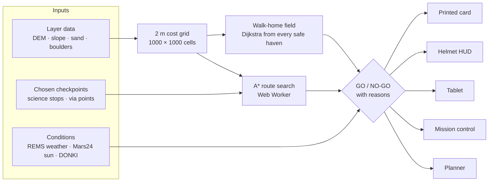

<div align="center">

# Martian Map

### Safe Marswalks, mapped.

Google Maps directions for one Marswalk: a hyperlocal route planner for two suited astronauts and a support rover, in the boxwork ridges of Mount Sharp, Gale Crater, where Curiosity worked in 2025–26.

**NASA Space Apps Challenge 2026 · *Interplanetary Survival Guide: Martian Map***

**[▶ Open the live app](https://interplanetary-survival-guide-marti-red.vercel.app)** · [Example plan](https://interplanetary-survival-guide-marti-red.vercel.app/#stops=t:msl-panorama,t:msl-valle-de-la-luna,t:msl-nevado-sajama,t:msl-nodules&rover=2) · [Quick start](#quick-start) · [Data sources](data/SOURCES.md) · [Credits and AI use](CREDITS.md)

</div>


<div align="center">

**1,000,000** terrain cells at 2 m · **7** real Curiosity stops · **10+** NASA datasets · **3** interfaces · **356** automated tests

</div>

---

## February 6, 1971: lost on the Moon


On Apollo 14's second moonwalk, **Alan Shepard and Edgar Mitchell** set out for the rim of **Cone Crater**. The terrain rolled, landmarks hid behind ridges, and their map was made for a much larger scale. They lost time, lost track of where they were, and **turned back short of the rim**.

### Now imagine it on Mars.

The first crew to walk on Mars will be further from help than anyone before them:

- **No GPS:** no satellite positioning on Mars.
- **No live link to Earth:** signals take 3 to 22 minutes each way.
- **No compass:** Mars has no global magnetic field.
- **Dangerous terrain:** sand traps, steep walls and boulder fields, in a suit with limited oxygen.

**Martian Map is the guide they would carry.**

<br clear="right">

<sub>LRO image of the Apollo 14 site: NASA/GSFC/Arizona State University. Path illustrative.</sub>

---

## 01 · Seven layers. One map.

Existing tools like Mars Trek map Mars at global and regional scale. A crew on foot needs **the scale of one walk**: a 2 × 2 km site at 2 m resolution. We layered real NASA data over exactly that site.

<table>
<tr>
<td width="25%" align="center"><br><b>1 · Imagery</b><br><sub>MRO HiRISE, ~25 cm/px</sub></td>
<td width="25%" align="center"><br><b>2 · Topography</b><br><sub>USGS Gale DEM, 1 m (HiRISE + CTX stereo)</sub></td>
<td width="25%" align="center"><br><b>3 · Slope</b><br><sub>from the DEM · 25° and up is a wall</sub></td>
<td width="25%" align="center"><br><b>4 · Terrain</b><br><sub>sand and boulders from HiRISE 25 cm</sub></td>
</tr>
<tr>
<td align="center"><br><b>5 · Thermal</b><br><sub>Mars Odyssey THEMIS night IR: warm rock, cool sand</sub></td>
<td align="center"><br><b>6 · Minerals</b><br><sub>MRO CRISM: blue water-bearing, green olivine</sub></td>
<td align="center"><br><b>7 · Walk home</b><br><sub>minutes to safety from every cell</sub></td>
<td align="center"><br><b>+ Radio shadow</b><br><sub>no line of sight to the habitat mast or rover</sub></td>
</tr>
</table>

Every value in the app carries a label: `OBSERVED`, `DERIVED`, `MODELED` (our assumption) or `MOCK`. Nothing assumed is ever shown as measured.

---

## 02 · Straight line vs. A* path

<table>
<tr>
<td width="50%" align="center"><br><b>Straight line</b><br>cuts straight through sand, slopes and walls</td>
<td width="50%" align="center"><br><b>A* path</b><br>follows the ridges, avoids the hazards, timed for a suited walker</td>
</tr>
</table>

The planner runs **A\*** over a walking-time model (Tobler's hiking function, slowed for a spacesuit, uphill and downhill treated differently) on the 2 m terrain grid, and judges every plan **GO or NO-GO, always with the reasons**:

| Check | Rule |
|---|---|
| **O₂ budget** | the walk fits the suit's 8 h with a 30 min reserve |
| **Point of no return** | from every point, an emergency walk home at 1.5× the planned time still fits the O₂ left |
| **Sunset** | back at least 30 min before sunset, from our own Mars24 clock |
| **Radiation and space weather** | alerts, the walk's dose, and real NASA DONKI CME forecasts for Mars |
| **Radio** | line of sight to the habitat mast or the rover |
| **Terrain** | time on sand, boulders and slopes over 15°; 25° and up is impassable |

<p align="center"></p>

The point of no return is checked **at every 2 m step** of the route, against the nearest safe haven: the habitat, or the rover where it is parked. The tablet and the HUD count it down live during the walk.

The safest route is the default. A faster one is offered only when it saves enough time to be worth the extra hazard, with the trade-off spelled out. The **rover** can carry the crew between distant stops: all seven stops take **3 h 13 min** riding and walking, against 4 h 42 min on foot.

<details>
<summary><b>See the rover-assisted plan and the conditions panel</b></summary>
<br>


</details>

---

## 03 · Curiosity's path, one tap away

<table>
<tr>
<td width="34%"></td>
<td width="33%"></td>
<td width="33%"></td>
</tr>
<tr>
<td><b>Curiosity's real track</b>, sols 4462–4983, drawn on the map where it crosses your walk.</td>
<td><b>Curiosity's own photos</b> at every stop, with what to study there and why, from NASA's mission reports.</td>
<td><b>A 360° view</b> rendered from the real elevation model, facing the way ahead (switch on the card). Labelled: not a photo.</td>
</tr>
</table>

The seven science stops sit exactly where Curiosity stood during its 2025–26 boxwork campaign: ridges, hollows, nodules and three drill sites. One line under the verdict sums it up: *Curiosity worked these 7 stops over 274 sols. This crew: one 4 h 42 min Marswalk.*

---

## 04 · One engine. Every route.



One judge decides GO or NO-GO for every view, so the planner, mission control, the tablet, the HUD and the printed card always agree. When the plan changes mid-walk, only the rest is re-planned, from where the crew and the rover really are: **the part already walked never changes**.

---

## 05 · One map. Three interfaces.

### Plan · the mission builder

Pick stops, rank them high, medium or low, choose a start in the GO window, stage the rover, and print a two-sided A4 Marswalk card. Every plan is a shareable link.

<table>
<tr>
<td width="62%"></td>
<td width="38%"></td>
</tr>
<tr>
<td><b>Printable Marswalk card:</b> map, checks, what to do if something goes wrong, and each stop in order.</td>
<td><b>Any screen:</b> phones, tablets and laptops.</td>
</tr>
</table>

### Steer · the habitat control post


Mission control follows the crew **live** and changes the rest of the walk while they move: drop or reorder stops, add a science target, send the crew through a point to get round a problem, or bring them straight home. Each change is planned from the crew's position, judged GO / NO-GO and drawn dashed **before** it is sent. Open the crew tablet in a second window and the two are linked; the new route reaches the crew with a message.

<p align="center"></p>

Between position reports, mission control moves the crew along the plan at their playback speed, so the dot moves smoothly even when the crew's window reports only once a second; each report corrects it.

### Walk · on the arm and in the visor

<table>
<tr>
<td width="50%"></td>
<td width="50%"></td>
</tr>
<tr>
<td><b>Tablet:</b> the leg being walked (bold blue, to the next stop) stands out from the rest of the path (faded) and the part already walked (grey). Next stop, bearing, O₂, point of no return, live warnings and Abort, with targets sized for gloved hands.</td>
<td><b>Helmet HUD:</b> where next, life support, live cautions and the EVA clock, over a real Curiosity view. <b>Abort</b> routes the crew to the nearer safe haven and shows the time to safety and the O₂ spare on arrival.</td>
</tr>
</table>

#### Running late

<table>
<tr>
<td width="50%"></td>
<td>

Before the walk, each stop gets a priority: **high, medium or low**. At a stop, the tablet shows how long the crew can stay and still be GO (*"221 min spare, then the point of no return"*), with **Stay 15 min longer**.

If a longer stay breaks the plan:

1. The rest of the walk is re-planned **from where the crew and the rover really are**.
2. Stops ahead are dropped in order: **lowest priority first**, then the one that costs the walk the most time.
3. Any dropped stop that turns out not to be needed is **put back**, so the cut is as small as possible.
4. A stop where the rover waits as safe haven is never dropped. If nothing helps, the tablet says: head back, use Abort.

</td>
</tr>
</table>

---

## 06 · Live location correction

There is no GPS on Mars. During the walk, the app's idea of where the crew is comes from the plan and the clock, and real walkers drift. **Get real position** corrects that, and plans the way back on the real terrain.

<p align="center"></p>

<table>
<tr>
<td width="50%"></td>
<td>

**What the crew sees:** the correction (dashed), the way back (pink), its length and time, and how much earlier or later the rest of the plan now runs. Playing on walks the pink path, then carries on from where it rejoins.

**The rules for the way back:**
- the quickest walkable path onto **the rest of the current leg**;
- **never back** over ground already walked;
- **never past the next stop**, so no science is skipped.

**Honest about the demo:** the fix itself is simulated (labelled `MOCK`): a 15–40 m drift onto walkable ground. A real crew would get it from their rover matching a 360° stereo view to the HiRISE map, as NASA's Mars Global Localization does for Perseverance. Swapping in a real fix means replacing one function, `getRealPosition()`.

</td>
</tr>
</table>

---

## 07 · Ask. Get a safe answer.

<table>
<tr>
<td width="34%"></td>
<td>

> **Navigator:** *Can we stay 20 more minutes?*
>
> **Copilot:** *Yes. The limit is 3 h 49 min, set by the point of no return. Move on by 07:49.*

1. **A language model reads the question** (typed or spoken).
2. **The safety engine sets every number.** The model never decides what is safe.
3. **Works offline:** without the model, a rules mode answers the same questions.

</td>
</tr>
</table>

---

## Quick start

You need **Node.js 22.12 or newer** ([download](https://nodejs.org), the LTS version is fine) and an **internet connection** (the HiRISE base map loads live from NASA Mars Trek). Check your version with `node --version`.

```bash
cd app
npm install
npm run dev
```

Open the address it prints (normally **http://localhost:5173**). All site data is already in the project; nothing else needs to be downloaded or built. Stop the server with `Ctrl+C`. The example plan on your machine: http://localhost:5173/#stops=t:msl-panorama,t:msl-valle-de-la-luna,t:msl-nevado-sajama,t:msl-nodules&rover=2

### Try it in 2 minutes

1. **Plan:** click the round white science targets on the map (or open the example plan). The route, the checks and the **GO / NO-GO** verdict appear on the left. Click a stop in the list for Curiosity's photos and the 360° view.
2. **Walk:** click **Tablet** (top right), then **Play walk**. Press **Get real position** to see a position fix and the pink path back.
3. **Steer:** click **Control**, then **Open crew tablet**. Put the two windows side by side, press **Play walk** in the crew window, and drop a stop in mission control: the crew gets the new route live.
4. Also try **HUD**, **Layers**, the **Mars clock** chip (start window, conditions, solar-storm drill) and **Print card**.

<details>
<summary><b>Other commands</b></summary>

Run these inside `app/`:

```bash
npm test           # unit tests
npm run typecheck  # TypeScript check
npm run build      # production build into app/dist
npm run preview    # serve that build at http://localhost:4173
```

If `npm install` fails or the page stays blank, check `node --version` first: older Node versions do not work with this project.

</details>

---

## Real data, labelled honestly

Every dataset is real. The one `MOCK` item is the demo position fix on the tablet.

| Layer or input | Source | Label |
|---|---|---|
| Base map | MRO HiRISE Curiosity-site mosaic (NASA Mars Trek) | OBSERVED |
| Elevation, slope, hillshade | USGS MSL Gale Merged DEM 1 m (HiRISE, CTX, HRSC) | DERIVED |
| Sand and rocky ground | Our rule applied to the USGS Gale 25 cm HiRISE orthophoto | MODELED |
| Night-time warmth (rock vs sand) | Mars Odyssey THEMIS night IR, 100 m (Mars Trek) | OBSERVED |
| Minerals from orbit (water-bearing, olivine sand) | MRO CRISM observation FRT0000B6F1, 18 m, smoothed to ~90 m (NASA PDS) | DERIVED (relative) |
| Science stops, Curiosity's path | Curiosity traverse (JPL MMGIS), mission blog, JPL news | DERIVED / OBSERVED |
| Stop photos | Curiosity Navcam and Hazcam raw images | OBSERVED |
| 360° views | Rendered from the DEM and orthophoto (not photos) | DERIVED |
| Weather on the planned sol | Curiosity REMS daily report, sol 4718 (2025-11-13) | MODELED (measured min/max, assumed curve) |
| Space weather | NASA DONKI: WSA-Enlil CME forecasts for Mars | MODELED |
| Walking speed, O₂, limits, habitat position, antenna heights | Our stated assumptions, each documented in the config | MODELED |
| Position fix ("Get real position" on the tablet) | Simulated 15–40 m drift (`app/src/localize/getRealPosition.ts`); the way back is planned on the real terrain | MOCK |
| Live link between mission control and the crew | Two windows of one browser (BroadcastChannel), standing in for the suit radio | SIMULATED |

**Mineral layer.** The official resources' CRISM mosaics do not cover this site, so it comes from a CRISM observation in NASA's PDS archive (FRT0000B6F1). Its signals are weak at this site, so it is smoothed to ~90 m and shown as relative strength, not abundances. The position fix is explained in [06 · Live location correction](#06--live-location-correction).

Full provenance for every dataset (product IDs, URLs, processing and checks) is in **[data/SOURCES.md](data/SOURCES.md)**.

## Credits and AI use

Built with the help of an AI coding assistant (Claude Code). **[CREDITS.md](CREDITS.md)** explains where AI was used and lists every data, code, font and method source. No NASA logos or branding are used, and no AI-generated images or video. The screenshots in this README are of this app; the Apollo 14 image is credited above.

## Rebuild the data (optional)

Not needed to run the app. Python 3.11+, from the project folder (not `app/`). Use `python3` on macOS/Linux if `python` is not found. Downloads are cached in `data/raw/` (git-ignored).

```bash
pip install -r pipeline/requirements.txt
python -m pytest pipeline              # pipeline tests

python -m pipeline gale-surface        # USGS DEM + 25 cm orthophoto → terrain grid with sand and rocky ground, habitat placed
python -m pipeline msl-targets         # Curiosity's boxwork stops placed on the grid
python -m pipeline msl-traverse        # Curiosity's path inside the site
python -m pipeline msl-images          # Curiosity raw images at each stop
python -m pipeline gale-panoramas      # 360° views rendered at the habitat and the stops
python -m pipeline themis-night-ir     # THEMIS night-IR overlay
python -m pipeline crism               # CRISM mineral overlay (downloads 2 bands, ~5 MB)
python -m pipeline msl-weather         # REMS weather for sol 4718
python -m pipeline donki               # space weather around that sol (NASA_API_KEY optional, DEMO_KEY otherwise)
python -m pipeline msl-weather         # again, so DONKI radiation alerts reach the conditions
```

`python -m pipeline build --dem <file.tif> --bbox <lonmin,latmin,lonmax,latmax> --out data/processed/<name>` converts any other elevation GeoTIFF into a terrain grid. See `--help` for sand and boulder masks.

## Layout

```
app/            Vite + React + TypeScript + Leaflet; route engine in a Web Worker (Vitest)
pipeline/       Python data pipeline: one converter per dataset in pipeline/sources/ (pytest)
data/           config.json, SOURCES.md (provenance), processed/ (what the app reads)
server/         optional voice copilot server (speech-to-text and a local LLM; see server/README.md)
assets/readme/  the images in this README
```

The app's optional copilot (`app/src/copilot/`) runs in offline rules mode when its server is not running, as on the live site.
