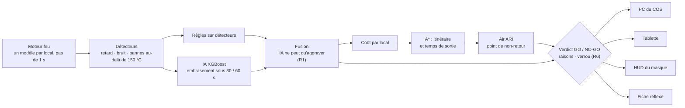

<div align="center">

# PNR · Point de Non-Retour

### À chaque seconde : l'engagement est-il encore tenable, par où sortir, et pourquoi ?

Aide à la décision pour la Protection civile lors d'un incendie sur site industriel.
Prévision de l'embrasement par IA · point de non-retour sur l'air de l'ARI · drone de reconnaissance simulé.

**Challenge Aero-Entrepreneur · Tunisian Aeroday × Protection civile × INJAZ**

[Lancer l'application](#lancer-lapplication) · [Rapport du modèle IA](ml/MODEL_REPORT.md) · [Données et sources](data/SOURCES.md) · [Crédits et usage de l'IA](CREDITS.md)

</div>

---

> *« Le point de non-retour, l'aviation le calcule pour chaque vol. Nous le calculons pour chaque pompier qui entre dans le feu. »*

**Prototype de démonstration.** Le site, le feu, les relevés des détecteurs, la position du binôme et le vol du drone sont **simulés**, et l'application l'affiche partout. Il n'y a eu aucun test en intervention réelle et aucune validation par la Protection civile à ce jour. Le verdict est une aide : **Décision : COS**.

## Le problème

Quand un binôme de sapeurs-pompiers entre dans une usine en feu, il ne sait pas si le local voisin va **s'embraser** (*flashover*), ni s'il lui reste **assez d'air** pour ressortir. Le chef de binôme et le COS décident à l'aveugle.

PNR répond en continu à trois questions : **l'engagement est-il encore tenable, par où sortir, et pourquoi ?**

- Une **IA** lit les détecteurs de chaleur du bâtiment, même quand ils tombent en panne, et prévoit l'embrasement d'un local **30 à 60 s à l'avance**.
- Un calcul de **point de non-retour** sur l'air de l'ARI vérifie que le binôme ressort avant le sifflet (55 bar), en comptant un retour 1,5 fois plus lent que prévu.
- Le verdict **GO / NO-GO** s'affiche avec ses raisons sur le PC du COS, la tablette du chef de binôme et le masque (HUD). Un NO-GO reste verrouillé : **seul le COS peut ré-engager**.
- Un **drone** de reconnaissance (simulé) part de l'engin, fait le tour du bâtiment hors du panache et surveille sa batterie avec la même logique de point de non-retour.

## Cinq fenêtres, un seul verdict

Le site de démonstration est un atelier fictif de pièces composites aéronautiques (60 × 40 m) : bureaux, TGBT, local de charge Li-ion, stockage de solvants, cabine de peinture, halle avec autoclave, 3 sorties, 15 détecteurs de chaleur. Aucune entreprise réelle n'est nommée.

| Écran | Pour qui | Contenu |
|---|---|---|
| **PC du COS** | le COS, au poste de commandement | Plan en direct (locaux teintés d'après les détecteurs, alertes IA, portes, binôme, drone), verdict et raisons, air et PNR, objectifs, journal. Le COS peut déclencher un départ de feu, ouvrir ou fermer une porte, engager, ajouter ou retirer un objectif, ordonner l'évacuation et ré-engager. |
| **Tablette** | le chef de binôme | Verdict, phase de la mission, prochain point, distance, pression, sortie prévue, marge PNR, alertes, messages du PC, et une **carte en direct** qui suit le binôme (cap en haut, nord en haut ou plan complet) avec les locaux teintés d'après leurs détecteurs. Gros boutons, pour les gants. |
| **HUD du masque ARI** | le porteur | Une seule alerte à la fois (icône + mot + couleur), air et PNR, lisibles en moins d'une seconde, sur une **vue synthétique** en première personne : le bâtiment reconstruit à partir du plan, avec portes, fumée et chaleur d'après les seuls détecteurs, chevrons de route au sol et alertes de l'IA. Elle est dessinée, pas filmée, et étiquetée SIMULATED. |
| **Fiche réflexe** | le binôme | Une page A4 imprimable : verdict, mission, air, plan, sorties, dangers de l'itinéraire avec des consignes sourcées. |
| **Jumeau numérique** | le jury, le COS | La réalité simulée à côté de ce que PNR en sait, la chaîne de décision en direct (détecteurs → 13 variables → IA et règles → fusion → verdict) et les courbes du local suivi. |

La tablette, le HUD et le jumeau numérique sont d'autres fenêtres du **même navigateur**, reliées en direct au PC (elles remplacent la radio).

## Comment ça marche

À chaque seconde de simulation, le PC est maître et diffuse le résultat ; la tablette et le HUD affichent sans simuler.



- **Moteur feu** : un seul moteur, utilisé par l'application et par la génération des données d'entraînement. Corrélations publiées et citées (NFPA 72, Kawagoe, MQH, Heskestad, Alpert, CFAST pour les jets de porte) dans [`data/SOURCES.md`](data/SOURCES.md).
- **Route et air** : le code vient de *Martian Map* (planificateur de sorties sur Mars avec réserve d'O₂), adapté à l'air de l'ARI : réserve d'O₂ → air de l'ARI, habitat → sorties, walk-home → temps de sortie.
- **Tout tourne dans le navigateur** : Vite, React, TypeScript, simulation dans un Web Worker. Pas de serveur, pas de base de données, pas d'authentification.

## L'IA en bref

Trois modèles **XGBoost**, évalués dans le navigateur par un évaluateur TypeScript sans dépendance, prédisent pour chaque local : P(embrasement ≤ 30 s), P(embrasement ≤ 60 s) et le délai avant l'embrasement, à partir de 13 variables tirées des seuls détecteurs de chaleur, détecteurs en panne compris.

| | Chiffre | Données |
|---|---|---|
| Embrasement sous 60 s, rappel | **0,95** (PR-AUC 0,76 contre 0,31 pour une règle sur la pente de température) | notre simulateur, SIMULATED |
| Embrasements annoncés / manqués | 893 / 12 sur 905, avance médiane **94 s** | notre simulateur, SIMULATED |
| Essais réels UL FSRI (120 expériences) | 11 embrasements sur 11 annoncés, avance médiane 54 s, **mais 92 locaux sur 109 qui ne s'embrasent pas déclenchent aussi une alerte** | essais réels, OBSERVED |

**Limite à dire franchement :** le modèle livré est entraîné sur notre propre simulateur, donc il en apprend les habitudes. Les jeux NIST P-Flash prévus n'étaient pas accessibles le 21 novembre, et le test sur essais réels montre trop de fausses alertes. Tous les détails (données, variables, étalonnage, limites, plan de validation avec la Protection civile) sont dans **[ml/MODEL_REPORT.md](ml/MODEL_REPORT.md)**.

## Le drone de reconnaissance

L'élément aéronautique : un drone thermique **simulé** qui décolle de l'engin et fait le tour du bâtiment à altitude fixe (30 m).

- Il reste **hors du panache** : un cône d'exclusion sous le vent, orienté par le vent réel du site (Open-Meteo, DERIVED).
- Il surveille sa **batterie** avec la même logique de point de non-retour que l'air de l'ARI : retour à l'engin garanti avec 25 % de réserve.
- Le vol est **refusé** au-delà de 12 m/s de vent.
- Son image thermique de toiture (SIMULATED) s'affiche sur le PC seulement et ne nourrit jamais le verdict.
- Autonomie, vitesse, vent maximal et résolution thermique sont ceux d'une classe de drones thermiques industriels (`data/config.json`, MODELED). Aucune marque n'est mise en avant. En Tunisie, **tout vol réel exige une autorisation préalable**.

## Huit règles de sécurité, chacune avec un test

| | Règle | Test |
|---|---|---|
| R1 | L'IA ne peut que dégrader un verdict (GO → NO-GO), jamais l'inverse | `app/src/danger/merge.test.ts` |
| R2 | Tout verdict affiché sur le PC, la tablette et la fiche porte « Décision : COS » ; le HUD ne montre que des alertes courtes | `app/src/stats/verdict.test.ts` |
| R3 | Tout nombre affiché porte son étiquette ; SIMULATED et MOCK ne ressemblent jamais à OBSERVED | `app/src/ui/labels.test.ts` |
| R4 | Toute hypothèse vit dans `data/config.json`, avec sa source et son statut | `app/src/config.test.ts` |
| R5 | Le verdict ne lit jamais la vérité du simulateur ni l'image thermique du drone : seulement les détecteurs (bruités, en panne) et l'IA | `app/src/sim/sim.test.ts` |
| R6 | Un NO-GO est verrouillé : seul le COS peut ré-engager, et l'action est journalisée | `app/src/stats/latch.test.ts` |
| R7 | Drone : retour garanti avec la réserve de batterie, vol refusé par vent fort, jamais dans la zone du panache | `app/src/drone/drone.test.ts` |
| R8 | L'évaluateur du navigateur reproduit les prédictions Python à 10⁻⁶ près, détecteurs en panne compris | `app/src/ml/xgb.test.ts` |

## Des données affichées honnêtement

Chaque nombre porte son étiquette, et une valeur vaut son entrée la plus faible.

| Étiquette | Signification |
|---|---|
| `OBSERVED` | Mesure réelle (essais UL FSRI) |
| `DERIVED` | Calculée à partir de mesures (le vent Open-Meteo est une analyse de modèle météo, pas une mesure sur site) |
| `MODELED` | Nos hypothèses, corrélations et valeurs normatives, et les données d'entraînement de notre moteur |
| `SIMULATED` | Produit par le moteur feu pendant la démonstration : relevés, prédictions de l'IA, image thermique du drone, liaison entre fenêtres |
| `MOCK` | Valeur factice (la position du binôme) |

Les références de chaque corrélation et de chaque jeu de données sont dans [`data/SOURCES.md`](data/SOURCES.md). Les consignes de la fiche réflexe sont des paraphrases de références publiques (ERG 2024, OSHA, NFPA 70E, EN 137) : elles doivent être relues contre leurs sources et **validées par la Protection civile** avant tout usage réel.

## Lancer l'application

Il faut **Node.js 22.12 ou plus récent** (24 recommandé), vérifiable avec `node --version`.

```bash
cd app
npm install
npm run dev
```

Ouvrir <http://localhost:5173> (écrire `localhost`, pas `127.0.0.1`).

- Tablette : <http://localhost:5173/?view=tablet>
- HUD : <http://localhost:5173/?view=hud>
- Jumeau numérique : <http://localhost:5173/?view=twin>

Ces fenêtres doivent être ouvertes dans le **même navigateur** que le PC, ce que font aussi les boutons « Ouvrir la tablette », « Ouvrir le HUD » et « Ouvrir le jumeau numérique » du PC. Aucun téléchargement n'est nécessaire : toutes les données sont dans le dépôt, et l'application fonctionne hors-ligne.

## Démonstration automatique

L'intervention se joue toute seule, sans clic, en environ 45 secondes (les temps de simulation sont accélérés ×5 à ×20 selon ce qui bouge) :

- HUD : <http://localhost:5173/?view=hud&demo=1>
- Tablette : <http://localhost:5173/?view=tablet&demo=1>
- Jumeau numérique : <http://localhost:5173/?view=twin&demo=1>
- PC du COS : <http://localhost:5173/?demo=1>, ou le bouton **Démo automatique** du PC (les fenêtres ouvertes depuis le PC bougent alors aussi)

Une fenêtre `&demo=1` simule et joue le scénario elle-même : ne pas l'ouvrir à côté d'un autre PC. Un bandeau commente chaque étape ; **Espace** met en pause, **R** recommence (les boutons apparaissent quand on bouge la souris). Le script joue le COS : il déclenche le feu, le drone, l'engagement, ferme la porte et ré-engage le binôme, mais il ne lit jamais la vérité du simulateur (R5) et le NO-GO reste verrouillé jusqu'à son ré-engagement, journalisé comme une décision du COS (R6). Les allures (`demo.paceFastX`, `paceWalkX`, `paceOutX`) sont dans `data/config.json` : mettre `paceWalkX` à 1 donne une marche en temps réel.

## Rejouer la démonstration à la main

Sur le PC, régler la vitesse sur **×20** puis cliquer **Lecture**. Les temps ci-dessous sont en temps simulé. Ouvrir la tablette et le HUD côte à côte pour voir la liaison en direct.

| T+ | Action | Ce qu'on voit |
|---|---|---|
| 0 s | **Départ de feu** (scénario : stockage de solvants) | Le local se teinte au fil des relevés des détecteurs |
| 60 s | **Décoller** le drone | Boucle autour du bâtiment, demi-tour de chaque côté du panache, batterie et marge de retour |
| 100 s | **Engager** le binôme (victime dans la cabine de peinture, puis coupure du TGBT) | **GO** et itinéraire |
| ≈ 214 s | rien, cela arrive tout seul | **NO-GO** « Embrasement prévu Cabine de peinture sous 60 s » ; itinéraire vers la sortie, alerte sur la tablette et le HUD |
| ensuite | Fermer la porte stockage ↔ cabine | Le score de l'IA retombe ; **le verdict reste NO-GO**, et le PC propose « Ré-engager (décision COS) » |
| ≈ 259 s | le binôme est dehors, à 272 bar | Cocher **Vérité simulateur** : l'embrasement réel de la cabine (286 s si la porte reste ouverte) montre que l'IA avait **72 s d'avance** |
| ensuite | Décocher l'objectif « Victime – cabine » puis **Ré-engager** | Nouvel itinéraire vers le TGBT, reçu en direct sur la tablette |
| fin | **Fiche réflexe** puis **Imprimer** | La fiche A4 avec les consignes sourcées |

## Commandes

À lancer dans `app/` :

```bash
npm test           # plus de 220 tests (règles R1 à R8, moteur feu, scénario de la démonstration, démo automatique)
npm run typecheck  # vérification des types
npm run build      # version de production dans app/dist
npm run preview    # sert ce build sur localhost:4173
```

Rafraîchir le vent réel (facultatif, l'application lit un cache) : `node scripts/fetch-weather.ts`.

## Réentraîner et valider le modèle

Les commandes complètes (génération des données, entraînement, évaluation sur les essais réels UL FSRI, validation du moteur feu) sont au [§9 du rapport du modèle](ml/MODEL_REPORT.md#9-reproduire). Les scripts `ml/*.ts` s'exécutent directement avec Node 24 ; la partie Python demande `pip install -r ml/requirements.txt`. Les données brutes restent hors du dépôt (`ml/data/raw/`).

## Organisation du dépôt

```text
app/        application web : Vite + React + TypeScript, simulation dans un Web Worker (Vitest)
  src/fire    moteur feu, un modèle par local            src/danger  règles, IA, fusion « ne peut qu'aggraver »
  src/ml      évaluateur XGBoost, variables du modèle    src/stats   air ARI, point de non-retour, verdict, verrou
  src/route   A*, temps de sortie, re-itinéraire         src/drone   reconnaissance, batterie, zone du panache
  src/sim     boucle de simulation (Web Worker)          src/live    liaison PC ↔ tablette ↔ HUD
  src/panels  PC du COS, tablette, HUD, fiche réflexe    src/site    plan de l'atelier (grille 0,5 m)
  src/scene   vue synthétique du HUD, carte de la tablette  src/twin   jumeau numérique
  src/demo    démonstration automatique (?demo=1)
data/       config.json (toutes les hypothèses), SOURCES.md, consignes.json, site/, weather/
ml/         données, entraînement, évaluation, modèles exportés (model/), rapports (report/), MODEL_REPORT.md
scripts/    fetch-weather.ts (vent Open-Meteo)
docs/       notes de conception du HUD
CLAUDE.md   règles du projet (sécurité, conventions)       PRODUCT.md  produit, utilisateurs, principes
```

## Limites assumées

- Le site, le feu, les relevés des détecteurs et le vol du drone sont **simulés** ; c'est affiché partout.
- Le modèle livré est entraîné sur notre simulateur, et il donne trop de fausses alertes sur les essais réels (voir le rapport).
- Les hypothèses d'air et de vitesse (bouteille ARI, consommation, progression en fumée, retour ×1,5) sont des **ordres de grandeur à valider** par la Protection civile.
- La position du binôme est **simulée** (`MOCK`) ; en vrai, il faudrait un système de localisation des pompiers en intérieur.
- La vue du HUD est **dessinée à partir du plan** (lancer de rayons sur la grille de l'atelier, un seul niveau, sans moteur 3D) : ce n'est pas une image de caméra, et elle ne lit jamais la vérité du simulateur.
- En Tunisie, tout vol réel de drone exige une autorisation préalable.
- PNR **aide** à décider ; il ne décide pas : **Décision : COS**.

## Crédits et licence

Ce dépôt part d'un instantané de **Martian Map** (NASA Space Apps Challenge 2026) dont il reprend le moteur de route et la logique de point de non-retour. Le code, les tests et la documentation ont été écrits avec l'aide d'un assistant IA (Claude Code). Toutes les sources, les données, les polices et l'usage de l'IA sont détaillés dans **[CREDITS.md](CREDITS.md)**.

Ce projet n'est approuvé ni par la Protection civile, ni par Tunisian Aeroday, ni par INJAZ, ni par la NASA. Licence [MIT](LICENSE).
