<div align="center">

# PNR · Point de Non-Retour

### Le binôme peut-il encore ressortir ? PNR répond à chaque seconde.

Aide à la décision pour la Protection civile, lors d'un incendie sur site industriel.<br>
Une IA prévoit l'embrasement d'un local d'après les détecteurs de chaleur. Un calcul de point de non-retour surveille l'air de l'ARI. Un drone simulé fait la reconnaissance.

**Challenge Aero-Entrepreneur · Tunisian Aeroday × Protection civile × INJAZ**

[Démarrage rapide](#démarrage-rapide) · [Rapport du modèle IA](ml/MODEL_REPORT.md) · [Données et sources](data/SOURCES.md) · [Crédits et usage de l'IA](CREDITS.md)

</div>

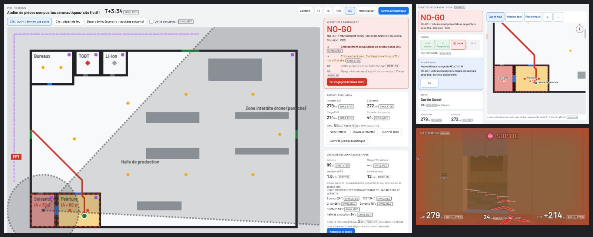

<div align="center">

**5** écrans reliés en direct · **3** modèles XGBoost sur **13** variables · **72 s** d'avance sur l'embrasement dans la démo (SIMULATED) · **120** essais réels pour juger l'IA · **13** règles de sécurité, chacune avec son test · **555** tests automatiques

</div>

---

## Entrer dans le feu, et en ressortir

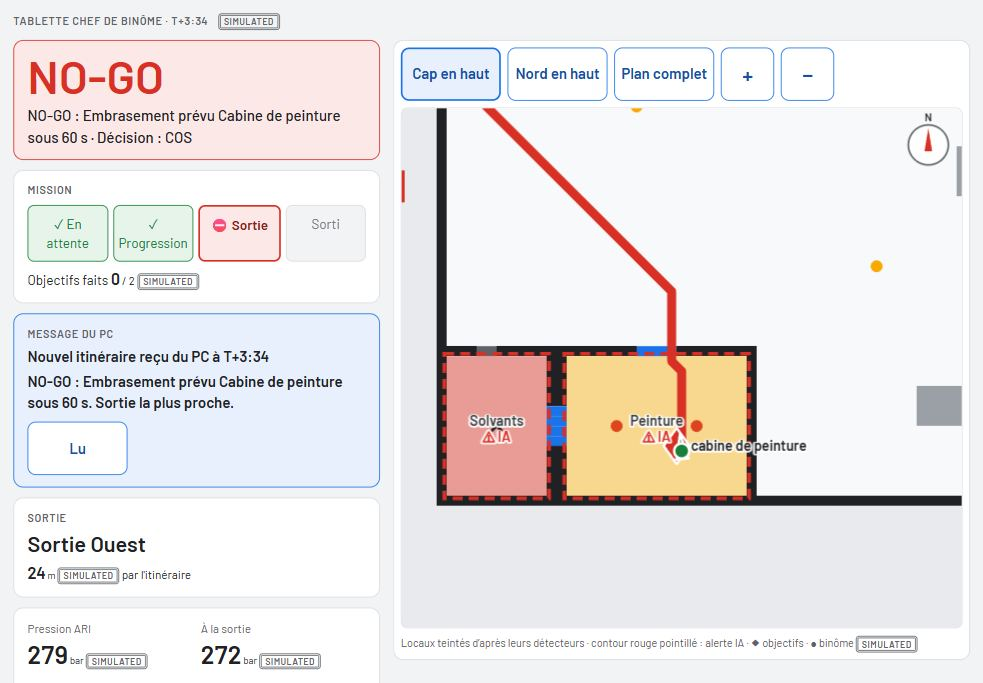

Un binôme de sapeurs-pompiers entre dans un atelier en feu. Deux questions comptent, et on ne peut pas y répondre à l'œil :

- **Le local voisin va-t-il s'embraser ?** L'embrasement (*flashover*), c'est le moment où tout le local prend feu d'un coup. Dans PNR, il est daté à l'instant où les gaz chauds sous le plafond atteignent 600 °C.
- **Reste-t-il assez d'air pour ressortir ?** Il faut être dehors avant le sifflet de l'ARI, à 55 bar, même si le retour est 1,5 fois plus lent que prévu.

PNR répond en continu, avec ses raisons, sur le PC du COS, la tablette du chef de binôme et le masque. Le verdict est une aide : **« Décision : COS »**.

**Prototype de démonstration.** Le site, le feu, les relevés des détecteurs et le vol des drones sont simulés, et l'application l'affiche à côté de chaque nombre. Il n'y a eu aucun test en intervention réelle, et aucune validation par la Protection civile à ce jour.

<br clear="right">

---

## 01 · Le feu grandit. L'IA prévient.

<table>
<tr>
<td width="50%" align="center">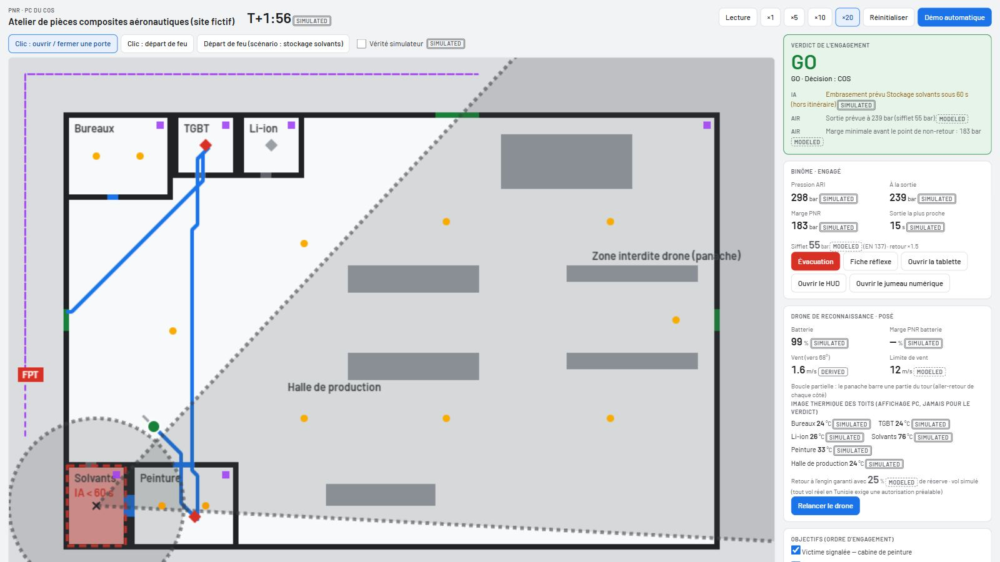<br><b>T+1:56 · GO</b><br><sub>itinéraire vers la victime puis le TGBT, sortie prévue à 239 bar</sub></td>
<td width="50%" align="center">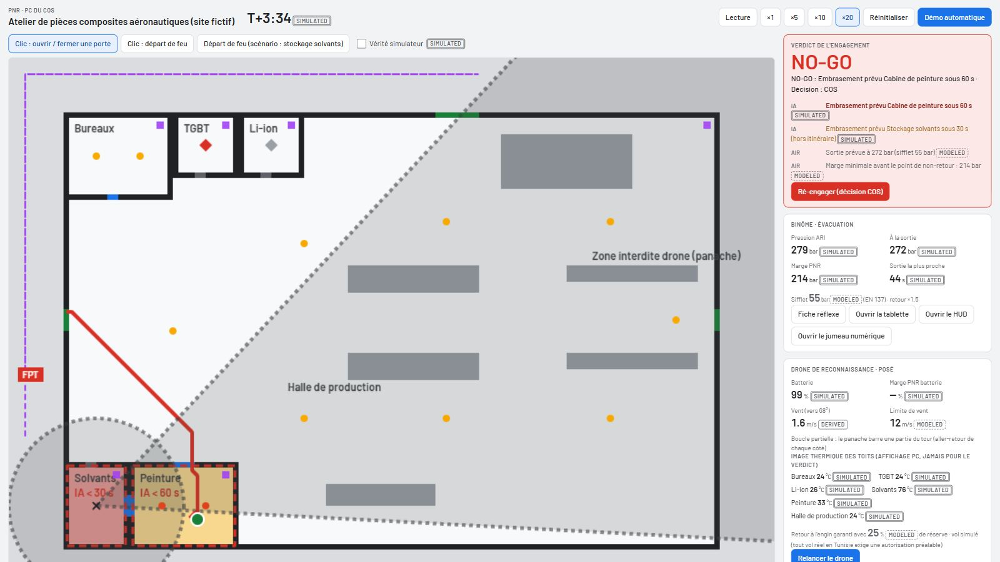<br><b>T+3:34 · NO-GO</b><br><sub>« Embrasement prévu Cabine de peinture sous 60 s » : demi-tour vers la sortie</sub></td>
</tr>
</table>

Le feu part dans le stockage de solvants. Les détecteurs de chaleur du bâtiment chauffent, puis tombent en panne au-delà de 150 °C. L'IA lit leurs relevés, pannes comprises, et annonce l'embrasement de la cabine de peinture voisine. Le verdict passe à **NO-GO**. Le binôme reçoit un nouvel itinéraire vers la sortie, et il ressort à **272 bar**, loin au-dessus du sifflet.

<table>
<tr>
<td width="58%">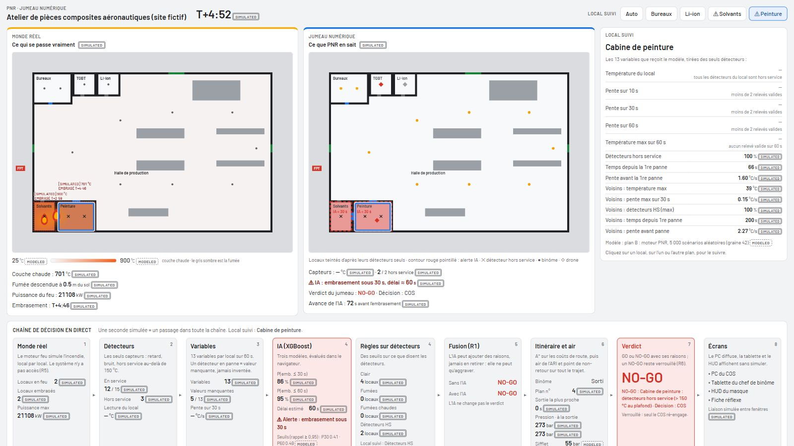</td>
<td>

**Combien d'avance ?** Le jumeau numérique montre côte à côte la réalité simulée et ce que PNR en sait. Porte laissée ouverte, la cabine s'embrase à T+4:46. L'IA l'avait annoncé à T+3:34 : **72 s d'avance** (SIMULATED).

PNR ne lit jamais cette réalité. Le verdict vient des seuls détecteurs et de l'IA (règle R5, testée). La case « Vérité simulateur » du PC sert seulement à mesurer l'avance, après coup.

</td>
</tr>
</table>

<details>
<summary><b>La chronologie complète de la démo</b> (temps simulé, graine 42)</summary>
<br>

| T+ | Ce qui se passe |
|---|---|
| 0 s | Départ de feu dans le stockage de solvants |
| 60 s | Le drone décolle de l'engin |
| 100 s | Le COS engage le binôme : **GO**, sortie prévue à 239 bar |
| 214 s | L'IA annonce l'embrasement de la cabine sous 60 s : **NO-GO**. Le COS fait fermer la porte stockage ↔ cabine |
| 226 s | Tous les détecteurs de la cabine sont en panne |
| 229 s | Le score P60 de la cabine est passé de 0,50 à 0,01 ; le verdict reste **NO-GO** |
| 262 s | Binôme dehors à **272 bar** ; le COS le ré-engage vers le TGBT : **GO**, sortie prévue à 242 bar |
| 286 s | Embrasement réel de la cabine, dans la variante où la porte reste ouverte |

Ces temps sont imprimés par le test [`app/src/sim/demo.test.ts`](app/src/sim/demo.test.ts).

</details>

---

## 02 · Une porte se ferme. Le NO-GO reste.

<table>
<tr>
<td width="50%" align="center">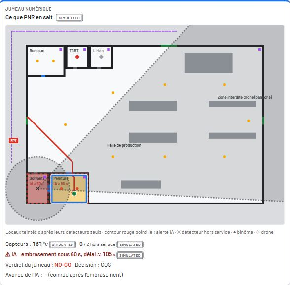<br><b>Porte ouverte</b><br><sub>« IA : embrasement sous 60 s, délai ≈ 105 s »</sub></td>
<td width="50%" align="center">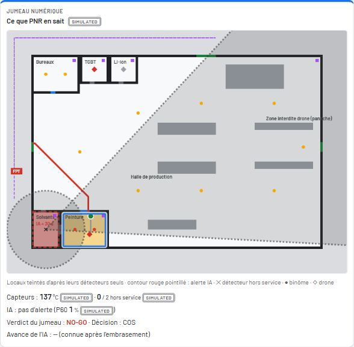<br><b>Porte fermée, 15 s plus tard</b><br><sub>« IA : pas d'alerte (P60 1 %) » · verdict toujours NO-GO</sub></td>
</tr>
</table>

Le COS fait fermer la porte entre le stockage et la cabine. La cabine reçoit moins de chaleur, et en 15 s son score d'embrasement sous 60 s tombe de 0,50 à 0,01. Pourtant **le verdict reste NO-GO**. PNR ne revient jamais tout seul au GO : seul le COS peut ré-engager, avec le bouton « Ré-engager (décision COS) », et l'action est journalisée (règle R6).

<table>
<tr>
<td width="50%">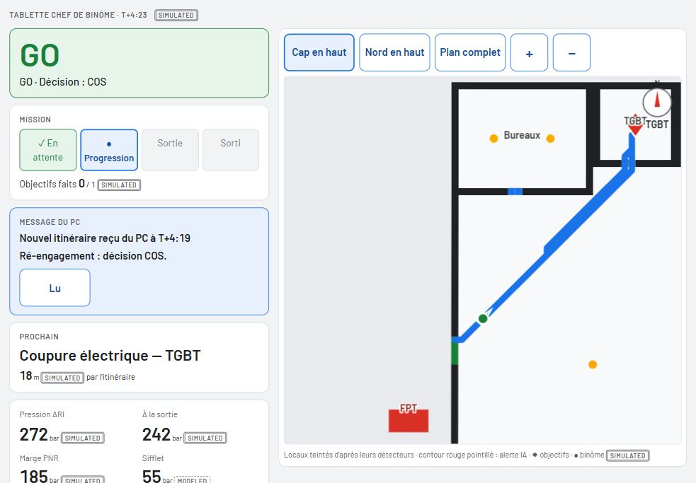</td>
<td>

**Le COS change la mission, la tablette suit.** Pendant l'évacuation, le PC retire l'objectif « Victime signalée — cabine de peinture ». Une fois le binôme dehors, le COS le ré-engage vers le TGBT.

La tablette reçoit le nouvel itinéraire en direct, avec le message « Ré-engagement : décision COS ». Le calcul repart de la position du binôme et de l'air qu'il lui reste : **GO**, sortie prévue à 242 bar.

</td>
</tr>
</table>

---

## 03 · L'air compte. Jusqu'au sifflet.

<p align="center">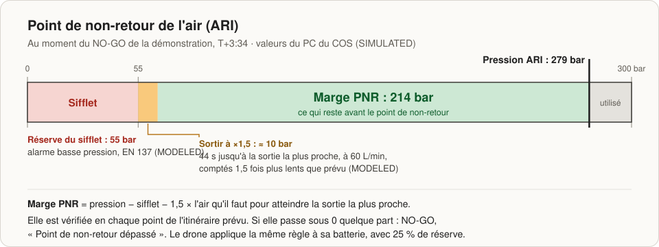</p>

L'itinéraire est calculé par **A\*** sur le plan de l'usine, découpé en cases de 0,5 m. Chaque local coûte plus cher à traverser quand les détecteurs ou l'IA y signalent un danger. Le temps de sortie est connu depuis chaque case.

Le point de non-retour est vérifié **en chaque point** de l'itinéraire prévu. NO-GO si la sortie prévue tombe sous le sifflet, ou si la marge passe sous zéro quelque part. Ce moteur de route et ce calcul viennent de [Martian Map](CREDITS.md), un planificateur de sorties sur Mars : l'oxygène du scaphandre est devenu l'air de l'ARI, l'habitat est devenu les sorties.

---

## 04 · Un drone. Hors du panache.

<table>
<tr>
<td width="60%">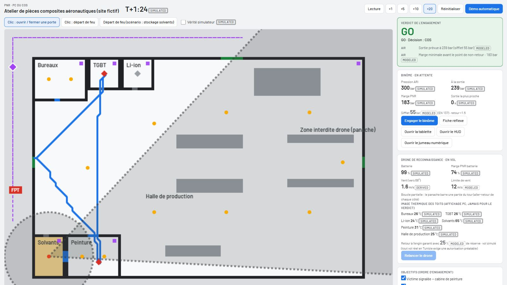</td>
<td>

L'élément aéronautique : un drone thermique **simulé** décolle de l'engin et fait le tour du bâtiment à 30 m. Quand le panache barre une partie du tour, il fait l'aller-retour de chaque côté.

- Il reste **hors du panache**, une zone orientée par le vent du site (analyse Open-Meteo, DERIVED).
- Il surveille sa **batterie** avec la même règle de point de non-retour que l'air : retour à l'engin garanti avec 25 % de réserve.
- Il **refuse de voler** au-delà de 12 m/s de vent.
- Son image thermique des toits s'affiche sur le PC seulement. Elle ne nourrit jamais le verdict.

En Tunisie, tout vol réel de drone exige une autorisation préalable.

</td>
</tr>
</table>

---

## 05 · Répéter avant d'entrer

<table>
<tr>
<td width="50%">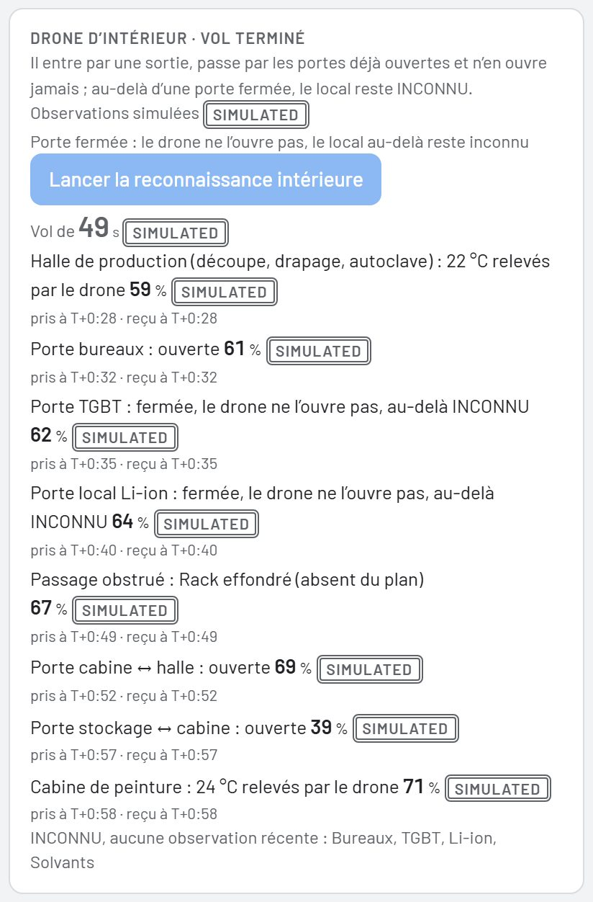</td>
<td width="50%">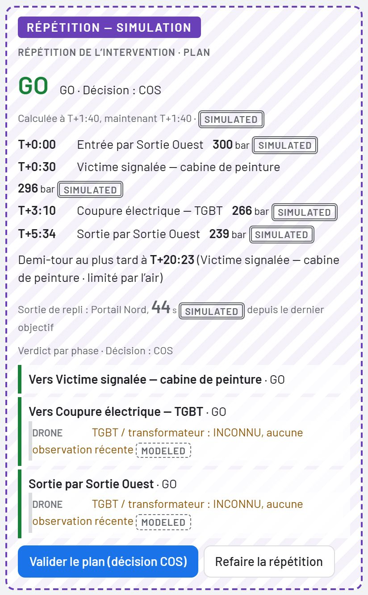</td>
</tr>
<tr>
<td><b>Le drone d'intérieur découvre.</b> Chaque observation porte son heure de prise de vue, son heure de réception, sa confiance. Le rack effondré n'est pas sur le plan : le drone le trouve.</td>
<td><b>PNR répète, le COS valide.</b> Le plan est un brouillon dans un cadre violet pointillé. Il ne s'applique qu'après « Valider le plan (décision COS) ».</td>
</tr>
</table>

Avant d'engager le binôme, PNR répète l'intervention. Un second drone, **d'intérieur**, entre par la sortie Ouest et fait le tour des locaux. Il passe par les portes déjà ouvertes et **n'en ouvre jamais**. Au-delà d'une porte fermée, le local reste **INCONNU** : une absence d'observation n'est jamais une preuve de sécurité (règle R9).

- Chaque observation porte son heure de prise de vue, sa position, sa confiance et sa source. Elle **vieillit**, et une fois expirée le local repasse à INCONNU. Dans une zone morte radio, elle n'arrive qu'au retour de la liaison (règle R10).
- Sur ce que PNR sait (détecteurs, IA, observations du drone) et jamais sur la vérité du simulateur (règle R11), la répétition joue l'intervention en vue première personne : itinéraire, air à chaque étape, contournement du rack, **heure de demi-tour**, sortie de repli, verdict phase par phase.
- Tout ce qui vient de la répétition porte « RÉPÉTITION — SIMULATION », dans un cadre violet pointillé, et n'apparaît jamais sur le HUD en direct (règle R12). « Engager sans répétition » reste toujours possible : sans plan, le binôme rencontre le rack, s'arrête devant, le signale, PNR ferme le passage et il contourne.
- Une fois le binôme engagé, le PC compare le plan au réel. Après un NO-GO, le plan est marqué « abandonné ».

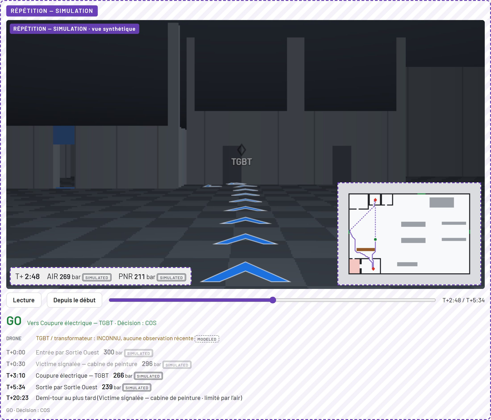

Les chiffres du drone d'intérieur (autonomie **9 min**, vitesse **1,5 m/s**, température maximale **50 °C**) sont ceux d'une classe de drones d'inspection à cage de protection, relus le 22 novembre dans les documents officiels du constructeur : citations, versions et pages dans [`data/SOURCES.md`](data/SOURCES.md). Ils restent `MODELED`, à valider par la Protection civile. Le drone n'entre jamais dans un local dont les détecteurs lisent 50 °C ou plus, et garde 25 % de batterie pour revenir.

---

## 06 · Cinq écrans. Un seul verdict.

Le PC du COS simule et diffuse. Les autres écrans affichent sans simuler : ce sont d'autres fenêtres du même navigateur, reliées en direct au PC. Elles tiennent le rôle de la radio.

<table>
<tr>
<td width="50%">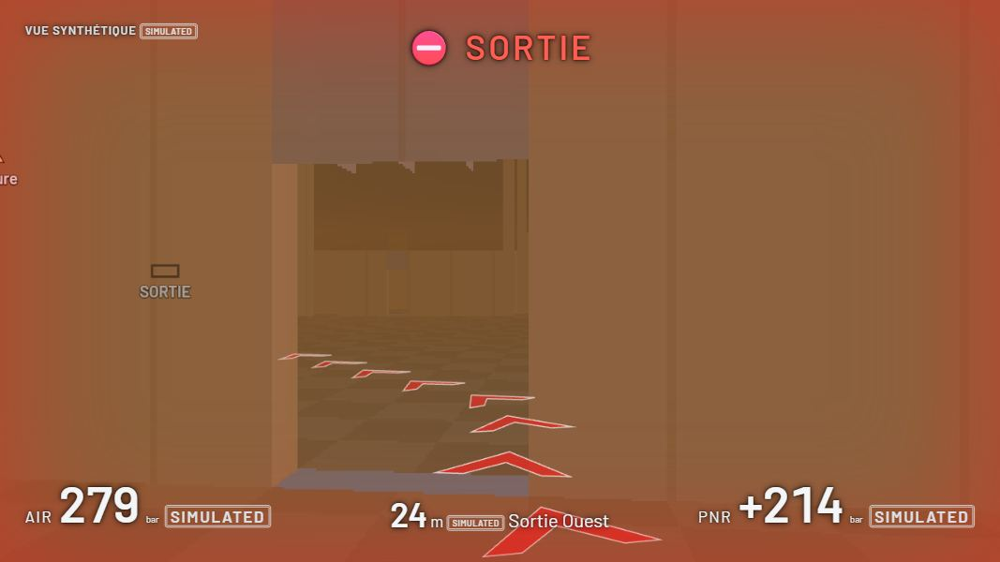</td>
<td width="50%">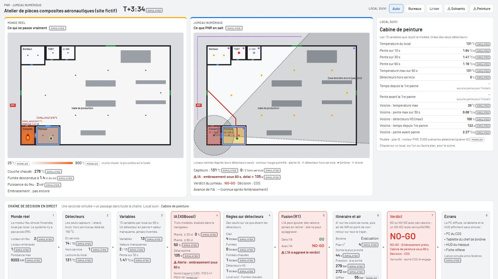</td>
</tr>
<tr>
<td><b>HUD du masque ARI.</b> Une seule alerte à la fois (icône, mot, couleur), l'air et la marge PNR, pensés pour être lus en moins d'une seconde. La vue est dessinée d'après le plan et les détecteurs, pas filmée.</td>
<td><b>Jumeau numérique.</b> La réalité simulée à côté de ce que PNR en sait, les 13 variables reçues par l'IA, et la chaîne de décision en direct.</td>
</tr>
<tr>
<td>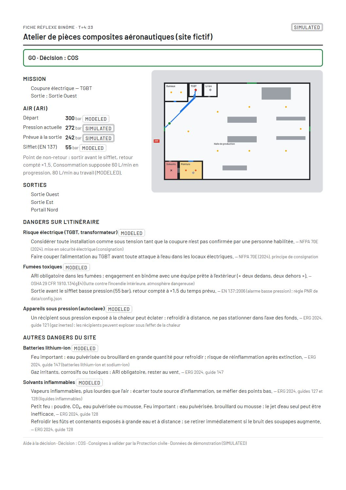</td>
<td>

**PC du COS** (en haut de page). Le plan en direct, le verdict et ses raisons, l'air, les drones, la répétition et les objectifs. Le COS déclenche un feu, ouvre ou ferme une porte, lance les drones, valide le plan, engage, retire un objectif, fait évacuer et ré-engage.

**Tablette du chef de binôme** (plus haut). Verdict, phase de la mission, prochain point, air, messages du PC, plan validé par le COS et carte qui suit le binôme. Gros boutons, pour les gants.

**Fiche réflexe** (à gauche). Une page A4 imprimable : verdict, mission, air, plan, sorties et dangers de l'itinéraire, avec des consignes sourcées à faire valider par la Protection civile. Le plan validé y figure aussi.

</td>
</tr>
</table>

Un seul moteur décide pour tous les écrans. À chaque seconde simulée, le PC fait tourner toute la chaîne :

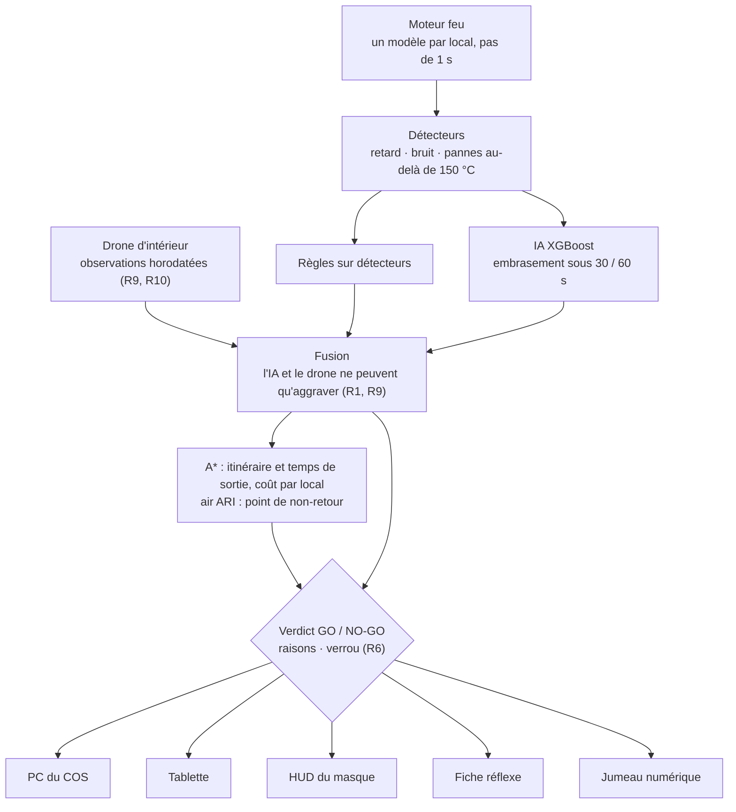

Tout tourne dans le navigateur : Vite, React, TypeScript, et la simulation dans un Web Worker. Pas de serveur, pas de base de données, pas de compte.

---

## 07 · Une IA qui ne peut qu'aggraver

Trois modèles **XGBoost** donnent, pour chaque local : un score d'embrasement sous 30 s, un score sous 60 s, et le délai estimé. Ils lisent **13 variables** tirées des seuls détecteurs de chaleur, détecteurs en panne compris. Ils tournent dans le navigateur, avec un évaluateur TypeScript sans dépendance.

L'IA peut ajouter un NO-GO ; elle ne peut jamais en retirer un (règle R1). Les seuils sont choisis pour annoncer au moins 95 % des embrasements en validation.

| Test | Résultat | Données |
|---|---|---|
| Notre simulateur, alerte « sous 60 s » | rappel **0,946**, précision 0,517, PR-AUC **0,761** (une règle simple sur la pente : 0,315) | 5 000 scénarios de notre moteur, SIMULATED |
| Notre simulateur, par local | 893 embrasements annoncés sur 905, avance médiane **94 s** | idem |
| Essais réels UL FSRI | 11 embrasements annoncés sur 11, avance médiane 54 s, **mais 92 fausses alertes sur 109** locaux qui ne s'embrasent pas | 120 essais en laboratoire, OBSERVED |

<p align="center">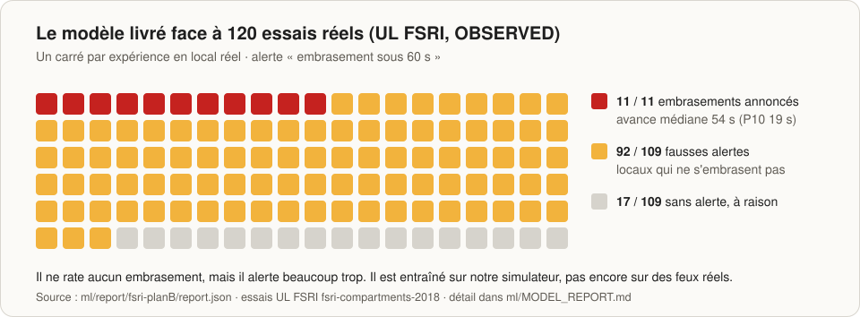</p>

**À dire franchement :** le modèle livré apprend sur notre propre simulateur. Les données NIST P-Flash prévues n'étaient pas accessibles le 21 novembre. Sur les essais réels, il ne rate aucun embrasement, mais il alerte beaucoup trop. Tout le détail, et le plan de validation avec la Protection civile, sont dans le [rapport du modèle](ml/MODEL_REPORT.md).

<details>
<summary><b>Le moteur feu face aux essais réels</b></summary>
<br>

<table>
<tr>
<td width="50%">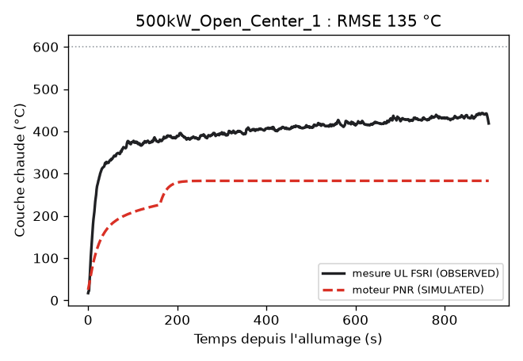</td>
<td width="50%">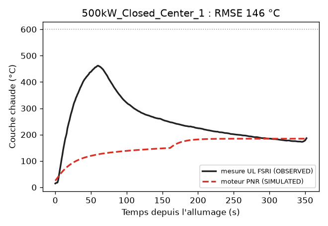</td>
</tr>
</table>

Nous avons rejoué 105 essais UL FSRI dans notre moteur feu. L'écart quadratique moyen sur la température des gaz chauds est de 105 °C porte ouverte et 110 °C porte fermée. Porte fermée, notre moteur plafonne vers 185 °C, alors que les mesures montent de 264 à 465 °C. Courbes noires : mesures (OBSERVED). Courbes rouges : notre moteur (SIMULATED).

</details>

---

## 08 · Treize règles. Chacune a son test.

| | Règle | Test |
|---|---|---|
| R1 | L'IA ne peut que dégrader un verdict (GO → NO-GO), jamais l'inverse | [`merge.test.ts`](app/src/danger/merge.test.ts) |
| R2 | Tout verdict sur le PC, la tablette et la fiche porte « Décision : COS » ; le HUD ne montre que des alertes courtes | [`verdict.test.ts`](app/src/stats/verdict.test.ts) |
| R3 | Tout nombre affiché porte son étiquette ; SIMULATED et MOCK ne ressemblent jamais à OBSERVED | [`labels.test.ts`](app/src/ui/labels.test.ts) |
| R4 | Toute hypothèse vit dans `data/config.json`, avec sa source et son statut | [`config.test.ts`](app/src/config.test.ts) |
| R5 | Le verdict ne lit que les détecteurs, l'IA et (R9) les observations du drone d'intérieur, jamais la vérité du simulateur ni l'image thermique du toit | [`sim.test.ts`](app/src/sim/sim.test.ts) |
| R6 | Un NO-GO est verrouillé : seul le COS peut ré-engager, et l'action est journalisée | [`latch.test.ts`](app/src/stats/latch.test.ts) |
| R7 | Drone : retour garanti avec la réserve de batterie, vol refusé par vent fort, jamais dans le panache | [`drone.test.ts`](app/src/drone/drone.test.ts) |
| R8 | Le navigateur reproduit les prédictions Python à 10⁻⁶ près, détecteurs en panne compris | [`xgb.test.ts`](app/src/ml/xgb.test.ts) |
| R9 | Une observation du drone d'intérieur ne peut qu'aggraver : un local non visité reste INCONNU, jamais « sûr », et le drone n'ouvre jamais une porte | [`known.test.ts`](app/src/knowledge/known.test.ts), [`indoor.test.ts`](app/src/drone/indoor.test.ts) |
| R10 | Une observation porte heure de prise de vue, position, confiance et source ; elle vieillit, et expirée le local repasse à INCONNU | [`known.test.ts`](app/src/knowledge/known.test.ts), [`indoor.test.ts`](app/src/drone/indoor.test.ts) |
| R11 | La répétition ne lit jamais la vérité du simulateur : la modifier ne change aucun résultat | [`engine.test.ts`](app/src/rehearsal/engine.test.ts), [`view.test.ts`](app/src/rehearsal/view.test.ts), [`demo.test.ts`](app/src/demo/demo.test.ts) |
| R12 | Tout ce qui vient de la répétition porte « RÉPÉTITION — SIMULATION » (cadre violet pointillé), jamais sur le HUD en direct ; le plan ne s'applique qu'après « Valider le plan (décision COS) » | [`plan.test.ts`](app/src/rehearsal/plan.test.ts), [`view.test.ts`](app/src/rehearsal/view.test.ts) |
| R13 | Le matériel USB (drone ESP32, HUD STM32) ne peut qu'aggraver : une lecture au-dessus du seuil ou un MAYDAY force le NO-GO ; un capteur muet, un paquet perdu ou une lecture qui baisse ne ramènent jamais le GO ; un rejeu est étiqueté REPLAY, jamais « en direct » | [`ingest.test.ts`](app/src/hardware/ingest.test.ts), [`pipeline.test.ts`](app/src/hardware/pipeline.test.ts), [`replay.test.ts`](app/src/hardware/replay.test.ts), [`firmware.test.ts`](app/src/hardware/firmware.test.ts) |

Un **audit de sécurité** (22/11, lecture du code) a relevé 12 pistes : 4 à valider, 8 réfutées, aucun secret ni injection ; le risque porte sur l'intégrité des règles, pas sur le vol de données. Les correctifs (rappel MAYDAY sous NO-GO verrouillé, étiquette d'un rejeu, vent illisible, messages du canal contrôlés, arbre XGBoost abîmé) ont chacun un test dans [`leads.test.ts`](app/src/security/leads.test.ts). Détail : [security/README.md](security/README.md).

Le copilote de la tablette suit ses propres garde-fous (C1 à C8 : lecture seule, jamais oui ou non sur l'engagement, consignes lues telles qu'écrites, rien sur le HUD), testés dans [`guardrails.test.ts`](app/src/copilot/guardrails.test.ts).

---

## 09 · Voir le feu depuis le drone (module `vision/`, prototype séparé)

Un second prototype de l'équipe regarde le flux caméra du drone. Un détecteur **YOLOv8s**, affiné sur le jeu public D-Fire, repère les flammes et la fumée ; une alerte n'est confirmée que si le feu apparaît sur au moins 4 des 8 dernières images. La détection est projetée sur une carte en grille (5 m par case), puis un automate stochastique simule l'extension possible du feu sous vent faible (10 km/h) et sous sirocco (40 km/h), avec les itinéraires d'évacuation et d'accès des camions.

| Mesure (rapport technique de l'équipe) | Valeur |
|---|---|
| Précision / rappel / mAP@0,5, jeu de test D-Fire | 0,777 / 0,707 / 0,781 |
| Images sans feu qui déclenchent une détection (par image, avant le filtre 4 sur 8) | ≈ 2,2 % |
| Vitesse, GPU RTX 4050 | ≈ 89 images/s |
| Au moins un bâtiment atteint à 45 min, 100 simulations (SIMULATED) | 8–13 % sous vent faible · 70–99 % sous sirocco |

- D-Fire est fait surtout de photos prises au sol : les performances vues depuis un drone restent à mesurer.
- La télémétrie du drone est simulée, la caméra supposée verticale, le terrain plat ; la propagation n'est pas calibrée.
- Ce module **n'est pas branché à l'application** : il ne nourrit pas le verdict de PNR.
- Les poids (`best.pt`, 22,5 Mo), le jeu D-Fire et les vidéos ne sont pas dans le dépôt.

Détail : [vision/README.md](vision/README.md) et [vision/RAPPORT_TECHNIQUE.pdf](vision/RAPPORT_TECHNIQUE.pdf).

---

## Démarrage rapide

Il faut **Node.js 22.12 ou plus récent** (24 recommandé) : vérifier avec `node --version`.

```bash
git clone https://github.com/ymhamdi/SAQROPS_198.git
cd SAQROPS_198/app
npm ci
npm run dev
```

Ouvrir <http://localhost:5173>. Aucun téléchargement de plus : toutes les données sont dans le dépôt, et l'application marche hors-ligne. Arrêter le serveur avec `Ctrl+C`.

### Essayez en 5 minutes

1. **Regarder la démo en une minute.** Cliquer **Démo automatique** sur le PC, ou ouvrir <http://localhost:5173/?demo=1>. L'intervention se joue toute seule, commentée étape par étape, répétition comprise ; **Pause** l'arrête. Ajouter `&rehearsal=0` pour l'histoire courte, sans répétition. Vue du masque : <http://localhost:5173/?view=hud&demo=1>, où **Espace** met en pause et **R** recommence.
2. **Ouvrir les autres écrans.** Sur le PC, cliquer « Ouvrir la tablette », « Ouvrir le HUD » et « Ouvrir le jumeau numérique ». Ces fenêtres doivent rester dans le **même navigateur** que le PC.
3. **Jouer le COS à la main.** Cliquer « Arrêter la démo » si elle tourne, puis **Réinitialiser**. Cliquer « Départ de feu (scénario : stockage solvants) », choisir **×20** et lancer la **Lecture**. Vers T+0:25, cliquer « Lancer la reconnaissance intérieure » ; vers T+1:00, « Décoller le drone » ; vers T+1:40, « Lancer la répétition ». Le plan s'affiche dans son cadre violet : « Valider le plan (décision COS) » engage le binôme, et « Engager sans répétition » reste possible.
4. **Après le NO-GO** (vers T+3:34) : cliquer sur la porte entre le stockage et la cabine pour la fermer, et décocher l'objectif « Victime signalée — cabine de peinture ». Une fois le binôme sorti, cliquer « Ré-engager (décision COS) ».
5. **Finir.** Cocher « Vérité simulateur » pour voir la réalité simulée, puis ouvrir la **Fiche réflexe** et cliquer **Imprimer**.

<details>
<summary><b>Autres commandes</b></summary>

À lancer dans `app/` :

```bash
npm test           # 555 tests : règles R1 à R13, audit de sécurité, garde-fous du copilote, moteur feu, répétition, matériel, démo
npm run typecheck  # vérification des types
npm run build      # version de production dans app/dist
npm run preview    # sert ce build sur http://localhost:4173
```

Les 4 tests Python et les commandes pour réentraîner et valider le modèle sont au [§9 du rapport du modèle](ml/MODEL_REPORT.md#9-reproduire). Les données brutes restent hors du dépôt.

</details>

---

## Étiqueté honnêtement

Chaque nombre affiché porte son étiquette. Une valeur vaut son entrée la plus faible : une prédiction de l'IA faite sur des relevés simulés est donc SIMULATED.

| Étiquette | Sens | Exemples |
|---|---|---|
| `OBSERVED` | Mesure réelle | Les 120 essais UL FSRI |
| `DERIVED` | Calculée depuis des mesures | Le vent Open-Meteo : une analyse météo, pas une mesure sur le site |
| `MODELED` | Nos hypothèses, normes et corrélations | Le plan de l'atelier, la bouteille de 300 bar, le sifflet à 55 bar (EN 137), le retour ×1,5, les caractéristiques des deux drones |
| `SIMULATED` | Produit par notre moteur pendant la démo | Le feu, les relevés, les prédictions de l'IA, l'image thermique, les observations du drone d'intérieur, la répétition, la liaison entre fenêtres |
| `MOCK` | Valeur factice | La position du binôme |

| Donnée | Source | Étiquette |
|---|---|---|
| Site : 60 × 40 m, 6 locaux, 3 sorties, 15 détecteurs | Atelier fictif de pièces composites aéronautiques ; aucune entreprise réelle | MODELED |
| Entraînement de l'IA | 5 000 scénarios de notre moteur feu | MODELED |
| Validation de l'IA et du moteur | UL FSRI, jeu de données fsri-compartments-2018 | OBSERVED |
| Vent au site | Open-Meteo, 1,6 m/s, cache du 21/11/2026 | DERIVED |
| Drone d'intérieur : autonomie 9 min, 1,5 m/s, 50 °C maximum | Documents officiels du constructeur d'une classe de drones à cage de protection, lus le 22/11/2026 ; références exactes dans `data/SOURCES.md` ; à valider par la Protection civile | MODELED |
| Consignes de la fiche réflexe | Paraphrases d'ERG 2024, OSHA, NFPA 70E, EN 137 ; à valider par la Protection civile | MODELED |

Chaque hypothèse vit dans `data/config.json` avec sa source. Toutes les références sont dans [`data/SOURCES.md`](data/SOURCES.md).

## Limites assumées

- Le site, le feu, les relevés, le vol des drones et leurs observations sont **simulés**, et c'est affiché partout.
- La répétition ne vaut que ce que PNR sait : un local que le drone n'a pas vu reste INCONNU, et une observation vieillit. C'est une aide à la préparation, pas une prédiction de l'intervention réelle.
- L'IA est entraînée sur notre simulateur, et elle donne trop de fausses alertes sur les essais réels.
- Les hypothèses d'air et de vitesse sont des **ordres de grandeur à valider** par la Protection civile.
- La position du binôme est factice (`MOCK`). En vrai, il faudrait localiser les pompiers à l'intérieur du bâtiment.
- La vue du HUD est dessinée d'après le plan : ce n'est pas une caméra.
- Le banc matériel est un prototype : deux cartes de développement, un capteur de pression et de température, un potentiomètre qui simule la bouteille. Plusieurs comportements restent non vérifiés sur carte (voir [firmware/README.md](firmware/README.md)).
- Le copilote de la tablette est une première version : une liste fermée de questions et des boutons, sans reconnaissance vocale ni LLM dans `main`.
- Le module `vision/` est un prototype séparé, non branché à l'application ; ses métriques viennent de photos prises au sol (D-Fire).
- PNR **aide** à décider ; il ne décide pas : « Décision : COS ».

<details>
<summary><b>Organisation du dépôt</b></summary>

```text
app/            application web : Vite + React + TypeScript, tests Vitest
  src/fire        moteur feu, un modèle par local
  src/danger      règles, IA, fusion « ne peut qu'aggraver »
  src/ml          évaluateur XGBoost, variables du modèle
  src/route       A*, temps de sortie, re-itinéraire
  src/stats       air ARI, point de non-retour, verdict, verrou
  src/drone       reconnaissance extérieure, batterie, zone du panache ; drone d'intérieur
  src/knowledge   « ce que PNR sait » : observations horodatées, vieillissement, INCONNU
  src/rehearsal   répétition de l'intervention, plan, comparaison plan / réel
  src/sim         boucle de simulation (Web Worker)
  src/live        liaison PC ↔ tablette ↔ HUD
  src/panels      PC du COS, tablette, HUD, fiche réflexe
  src/scene       vue du HUD, carte de la tablette
  src/twin        jumeau numérique
  src/demo        démonstration automatique (?demo=1)
  src/site        plan de l'atelier (grille 0,5 m)
  src/hardware    liaison USB (Web Serial) : drone ESP32, HUD STM32, rejeu
  src/copilot     copilote de la tablette : liste fermée de questions, réponses calculées par PNR
firmware/       croquis Arduino du drone (ESP32) et du HUD (STM32), câblage, résultats du banc
vision/         détection feu et fumée par caméra (YOLOv8s), localisation, propagation, évacuation (Python, prototype séparé)
data/           config.json (toutes les hypothèses), SOURCES.md, consignes.json
ml/             données, entraînement, évaluation, modèles, MODEL_REPORT.md
security/       audit de sécurité : rapport, pistes à valider, correctifs
scripts/        fetch-weather.ts (vent Open-Meteo)
```

La liaison matérielle par USB (drone sur ESP32, HUD sur STM32, via Web Serial, Chrome ou Edge) est dans `main`. Les deux croquis ont été **compilés et téléversés le 22/11** sur les cartes du banc, et leurs lignes passent dans l'analyseur de l'application ; restent **non vérifiés sur carte** le MAYDAY déclenché à la main, la course complète du potentiomètre et le texte du LCD. Détail : [firmware/README.md](firmware/README.md).

</details>

## Crédits et licence

PNR part d'un instantané de **Martian Map** (NASA Space Apps Challenge 2026), dont il reprend le moteur de route et la logique de point de non-retour. Le code, les tests et la documentation ont été écrits avec l'aide d'un assistant IA (Claude Code). Les images de cette page sont des captures de l'application et des graphiques du projet ; aucune n'est générée par IA. Les sources, les données, les polices et l'usage de l'IA sont détaillés dans [CREDITS.md](CREDITS.md).

Ce projet n'est approuvé ni par la Protection civile, ni par Tunisian Aeroday, ni par INJAZ, ni par la NASA. Licence [MIT](LICENSE).
