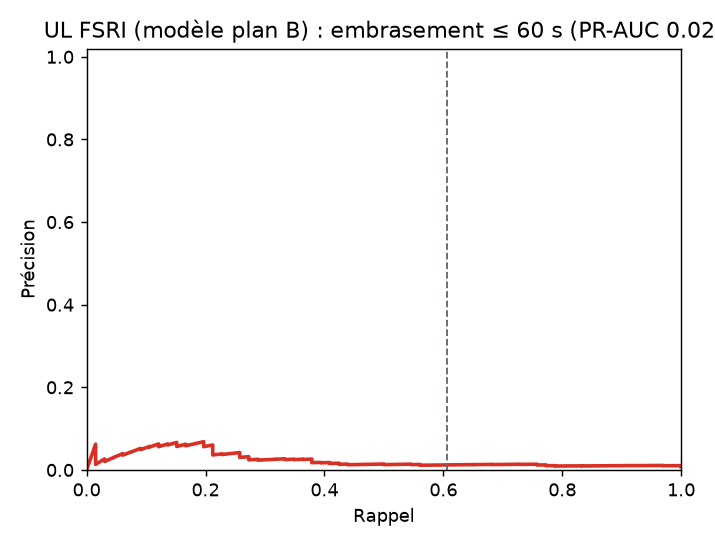
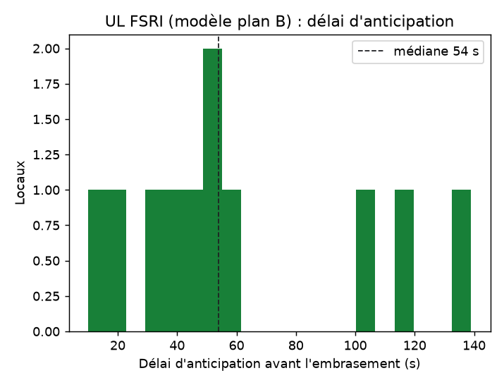
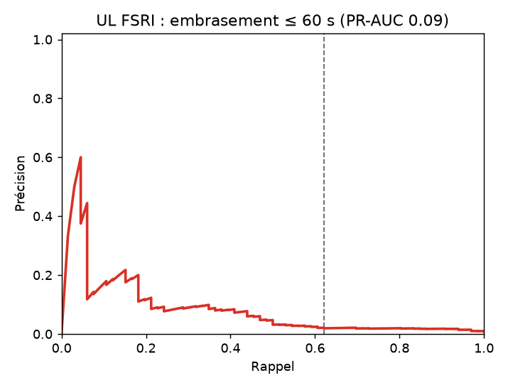
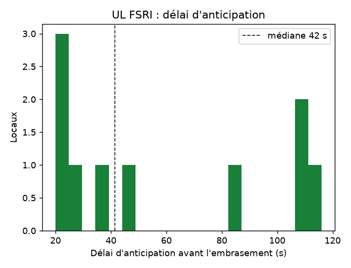
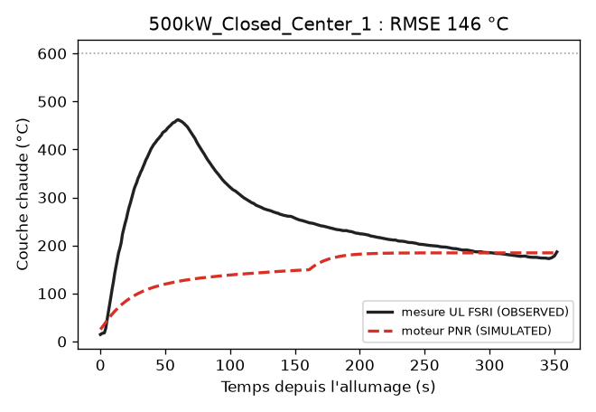
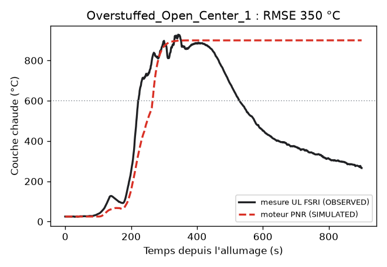

# Rapport du modèle IA — PNR · Point de Non-Retour

*Livrable « Rapport du modèle IA » du challenge Aero-Entrepreneur (Tunisian Aeroday × Protection civile × INJAZ). État au 21 novembre 2026.*

Tous les chiffres de ce rapport viennent de fichiers du dépôt (`ml/model/metrics.json`, `ml/report/`, `data/config.json`) et sont produits par les scripts listés au [§9](#9-reproduire). Chaque donnée porte son étiquette, comme dans l'application : **OBSERVED** mesure réelle · **DERIVED** calculée à partir de mesures · **MODELED** hypothèse, corrélation ou norme · **SIMULATED** produite par notre moteur feu · **MOCK** valeur factice.

---

## 1. En bref

- **Ce que le modèle prédit.** Pour chaque local d'un bâtiment : la probabilité que le local s'embrase (*flashover*) dans les 30 s, dans les 60 s, et le délai estimé avant l'embrasement. Il lit uniquement les détecteurs de chaleur du bâtiment, **y compris quand ils tombent en panne** (au-delà de 150 °C).
- **Comment.** Trois modèles XGBoost alimentés par 13 variables par local, exécutés dans le navigateur : pas de serveur, pas de licence.
- **Avec quelles données.** Le modèle livré est entraîné sur 5 000 scénarios (364 990 exemples) produits par notre propre moteur feu (**MODELED**). Les jeux NIST P-Flash prévus n'ont pas pu être téléchargés : le serveur du NIST était indisponible le 21 novembre.
- **Sur nos propres données (SIMULATED).** Embrasement sous 60 s détecté dans 94,6 % des cas ; 893 des 905 embrasements du jeu de test sont annoncés, avec 94 s d'avance en médiane ; PR-AUC 0,76 contre 0,31 pour une règle sur la pente de température.
- **Sur des essais réels (UL FSRI, 120 expériences, OBSERVED).** Les 11 embrasements sont annoncés (54 s d'avance en médiane), **mais 92 des 109 locaux qui ne s'embrasent pas déclenchent aussi une alerte (84 %)**. C'est la limite principale du modèle livré ([§6](#6-limites)). Une version v3, entraînée sur des feux plus variés, descend à 72 fausses alertes sur 109 (66 %) mais manque un embrasement ; elle n'est pas encore livrée.
- **Rôle dans la décision.** L'IA ne peut qu'**aggraver** un verdict (GO → NO-GO), jamais l'adoucir (règle R1). Le verdict est une aide : **la décision appartient au COS**.

> **Lire les chiffres.** *Rappel* : part des cas dangereux détectés. *Précision* : part des alertes qui étaient justifiées. *PR-AUC* : qualité globale du compromis rappel/précision (1 = parfait ; un tirage au hasard donne la fréquence des cas dangereux : 10 % sur nos données, environ 1 % sur les essais réels). *Avance* : temps entre la première alerte et l'embrasement.

---

## 2. Le problème et la place de l'IA

Un binôme de sapeurs-pompiers entre dans un site industriel en feu. Deux choses peuvent le piéger : le **local voisin s'embrase** sans prévenir, ou l'**air de l'ARI** ne suffit plus pour ressortir. PNR calcule les deux en continu et affiche un verdict GO / NO-GO avec ses raisons (PC du COS, tablette du chef de binôme, HUD du masque, fiche réflexe).

L'IA traite la première moitié du problème : **voir venir un embrasement 30 à 60 s à l'avance avec des capteurs déjà présents dans le bâtiment**, les détecteurs de chaleur. Ces détecteurs cessent de répondre au-delà de 150 °C, c'est-à-dire juste au moment où l'information compte ; le modèle apprend à exploiter ce qu'ils disaient *avant* de tomber en panne, et le fait même qu'ils tombent en panne. C'est l'approche du NIST P-Flash (Tam et al.).

À chaque seconde de simulation, la chaîne est la suivante :

```
moteur feu → relevés des détecteurs (retard, bruit, pannes) → 13 variables par local
          → 3 modèles XGBoost → alerte « Embrasement prévu <local> sous 30 s / 60 s »
          → coût de route ×60 dans ce local → règles sur détecteurs + IA fusionnées
          → verdict GO / NO-GO avec ses raisons (« Décision : COS »)
```

Garde-fous liés à l'IA, chacun vérifié par un test automatique :

| Règle | Contenu | Test |
|---|---|---|
| R1 | L'IA ne peut que dégrader un verdict (GO → NO-GO), jamais l'inverse | `app/src/danger/merge.test.ts` |
| R5 | Le verdict ne lit jamais la « vérité » du simulateur ni l'image thermique du drone : seulement les détecteurs (bruités, en panne) et l'IA | `app/src/sim/sim.test.ts` |
| R6 | Un NO-GO est verrouillé : seul le COS peut ré-engager, l'action est journalisée | `app/src/stats/latch.test.ts` |
| R8 | L'évaluateur TypeScript reproduit les prédictions Python à 10⁻⁶ près, valeurs manquantes comprises | `app/src/ml/xgb.test.ts` |

---

## 3. Données

### 3.1 Prévues : NIST P-Flash (MODELED)

- NIST mds2-2258 : 1 000 simulations CFAST d'une structure à trois locaux. <https://data.nist.gov/od/id/mds2-2258>
- NIST mds2-2479 : 20 000 simulations CFAST, six locaux, ouvertures de portes. <https://data.nist.gov/pdr/lps/ark:/88434/mds2-2479>

Ces jeux sont **des simulations**, pas des mesures : même avec eux, le modèle resterait entraîné sur des données `MODELED`. Notre étiquette (embrasement = couche chaude à 600 °C) et notre règle de panne (détecteur muet au-delà de 150 °C) reprennent celles de P-Flash.

**Statut au 21 novembre 2026 : non utilisés.** `data.nist.gov` renvoyait des erreurs 524 dès 14 h 10, puis HTTP 503 à 17 h 05. `ml/download.py` retente automatiquement (reprise HTTP Range, vérification SHA-256). Le script de conversion des fichiers NIST vers le format du contrat reste à écrire une fois les données récupérées.

### 3.2 Utilisées : le « plan B », des scénarios de notre propre moteur (MODELED, SIMULATED)

`ml/generate.ts` fait tourner **le même moteur feu que l'application** (`app/src/fire/`, corrélations citées dans [`data/SOURCES.md`](../data/SOURCES.md)) et calcule les variables avec **le même code** (`app/src/ml/features.ts`) : l'entraînement et l'application ne voient jamais des entrées différentes.

Chaque scénario est un bâtiment tiré au hasard :

- une chaîne de 2 à 4 locaux (3 à 8 m × 3 à 10 m, hauteur 2,4 à 4,5 m, murs en plâtre dans 65 % des cas, sinon en béton), reliés par des portes de 0,8 à 2,0 m, dont un local ouvert sur l'extérieur ;
- 1 à 2 détecteurs de chaleur par local ;
- un feu dans un local tiré au hasard, allumé entre 0 et 90 s, à croissance en t² (lente, moyenne, rapide ou ultra-rapide, NFPA 72 Annexe B) ;
- des portes ouvertes dans 70 % des cas, avec dans 30 % des scénarios une porte qui change d'état entre 60 et 400 s ;
- 720 s simulées, un échantillon toutes les 10 s ; tous les échantillons situés dans les 120 s avant un embrasement sont gardés, 35 % des autres.

Le modèle livré (**v1**) a été entraîné avec la version du générateur du commit `1cad7b1` : 5 000 scénarios, 364 990 exemples, des feux limités seulement par la ventilation, une étanchéité identique partout. Le générateur actuel y ajoute des feux limités par leur combustible (pic de 50 kW à 3 MW, plateau, extinction), des feux rapides (flaques, fuites de gaz) et une étanchéité variable de 1× à 20× ; il produit les données de la **v3** ([§5.3](#53-essais-réels-ul-fsri-observed)). Toutes ces plages sont dans `data/config.json` (`dataset.*`) avec leur source.

**Découpage par scénario, jamais par pas de temps** : `crc32(scénario) mod 100` < 70 → entraînement (253 918 exemples), < 85 → validation (59 207), sinon test (51 865).

### 3.3 Validation sur essais réels : UL FSRI (OBSERVED)

*fsri-compartments-2018* : 120 expériences de feu en compartiment à échelle réelle, dans une pièce de 3,7 × 3,7 × 2,4 m avec une porte de 0,9 × 2,0 m ouverte ou fermée (brûleur à gaz de 100, 250 ou 500 kW, ou mobilier). <https://github.com/ulfsri/fsri-compartments-2018>

Le modèle n'est pas modifié pour ce test : on lui fournit seulement des entrées fabriquées à partir des mesures (`ml/prepare_fsri.py`) :

- chacun des quatre thermocouples situés à 25 mm sous le plafond devient un détecteur de chaleur : sa température passe par le modèle de retard du détecteur (RTI, mêmes paramètres que le simulateur), la vitesse des gaz étant donnée par la corrélation d'Alpert au débit calorifique mesuré. Le signal est donc **DERIVED** ;
- la panne au-delà de 150 °C est appliquée comme dans le simulateur ;
- l'étiquette est **OBSERVED** : premier instant où la moyenne des quatre thermocouples situés à 0,3 m sous le plafond atteint 600 °C. **11 expériences sur 120** l'atteignent ;
- chaque expérience est coupée à l'extinction ou à l'arrêt du brûleur.

---

## 4. Le modèle

**Trois modèles XGBoost**, un par cible (contrat : [`ml/model/contract.json`](model/contract.json)) :

| Modèle | Cible | Type |
|---|---|---|
| `p30` | le local s'embrase dans les 30 s | classification binaire |
| `p60` | le local s'embrase dans les 60 s | classification binaire |
| `tff` | secondes avant l'embrasement, plafonnées à 300 s | régression |

**13 variables par local**, calculées sur les 60 dernières secondes, sans rien qui dépende de la géométrie du bâtiment :

| Groupe | Variables |
|---|---|
| Le local lui-même (8) | température du local maintenant (max des détecteurs valides) · pente de température sur 10, 30 et 60 s · température max sur 60 s · part de détecteurs en panne · temps écoulé depuis la première panne · pente sur les 30 s qui ont précédé cette panne |
| Les locaux voisins, reliés par une porte (5) | température max · pente max sur 30 s · part max de détecteurs en panne · plus ancienne panne · pente max avant panne |

Un détecteur en panne vaut **valeur manquante** (NaN), jamais une valeur inventée.

**Entraînement** (`ml/train.py`) : profondeur 6, taux d'apprentissage 0,08, 90 % des lignes et des colonnes par arbre, poids minimal de nœud 5 (le modèle de délai de la v1 garde la valeur par défaut), arrêt anticipé après 40 itérations sans progrès sur la validation (400 maximum), classes rééquilibrées pour les deux classifieurs (`scale_pos_weight`), graine 42, XGBoost 3.4.1. Le modèle livré compte 263, 256 et 375 arbres.

**Seuils de décision** : le plus haut seuil qui garde un rappel d'au moins 0,95 sur la validation, soit 0,41 pour `p30` et 0,49 pour `p60`. Choix assumé : on préfère une fausse alerte à un embrasement manqué.

**Pourquoi XGBoost.**

1. Des données tabulaires de 13 variables : les arbres boostés y sont un choix classique et robuste.
2. Les valeurs manquantes sont gérées par le modèle lui-même : un détecteur en panne suit la direction par défaut de chaque nœud.
3. Les variables ont un sens physique (pente de température, temps depuis la première panne) : c'est plus facile à expliquer à un COS qu'un réseau opaque.
4. Il s'exécute dans le navigateur avec un évaluateur TypeScript d'environ 85 lignes (`app/src/ml/xgb.ts`), sans dépendance : pas de serveur, pas de licence, hors-ligne. La parité avec Python est testée sur 300 lignes (`ml/model/golden.csv`, dont au moins un tiers avec des détecteurs en panne).

Un modèle séquentiel (réseau récurrent) **n'a pas été entraîné** : la comparaison n'a pas été faite.

---

## 5. Résultats

### 5.1 Sur notre jeu de test (SIMULATED)

51 865 exemples issus de scénarios que le modèle n'a jamais vus. Attention : ce jeu vient du **même simulateur** que l'entraînement, ce qui rend ces chiffres flatteurs (voir §5.3 pour des feux réels).

| | ≤ 30 s | ≤ 60 s |
|---|---|---|
| Seuil (rappel ≥ 0,95 sur la validation) | 0,41 | 0,49 |
| Rappel | 0,957 | 0,946 |
| Précision | 0,308 | 0,517 |
| PR-AUC | 0,560 | 0,761 |
| Score de Brier | 0,074 | 0,070 |
| Cas dangereux dans le test | 2 715 (5,2 %) | 5 430 (10,5 %) |

- **Contre une règle simple** (pente sur 30 s + part de détecteurs en panne, même objectif de rappel) : PR-AUC 0,315 et précision 0,321 pour `p60`, contre 0,761 et 0,517.
- **Par local** (un local qui s'embrasse est « détecté » si l'alerte à 60 s monte au moins une fois avant l'embrasement) : **893 sur 905 détectés (98,7 %)**, 12 manqués ; avance médiane **94 s**, 10 % des cas avec moins de 52 s, 90 % avec moins de 175 s.
- **Délai estimé** (`tff`) : erreur absolue moyenne **46 s** sur 16 180 exemples d'embrasements.

### 5.2 Étalonnage : des scores, pas des probabilités

Table pour `p60` sur le jeu de test :

| Score prédit | Exemples | Prédit (moyenne) | Observé |
|---|---|---|---|
| 0,0 – 0,1 | 39 248 | 0,004 | 0,001 |
| 0,3 – 0,4 | 574 | 0,351 | 0,117 |
| 0,5 – 0,6 | 587 | 0,552 | 0,140 |
| 0,7 – 0,8 | 1 196 | 0,754 | 0,273 |
| 0,9 – 1,0 | 4 669 | 0,944 | 0,725 |

Le modèle classe bien les cas mais **surestime** les scores, ce qui est attendu avec des classes rééquilibrées. L'alerte se déclenche sur un seuil ; tant que les scores ne sont pas recalibrés, il ne faut pas les lire comme des probabilités.

### 5.3 Essais réels UL FSRI (OBSERVED)

Même modèle, mêmes seuils (choisis sur données simulées), 120 expériences réelles, un local par expérience. Sources : v1 dans `ml/report/fsri-planB/report.json` ; v3 dans le message du commit `db6afc4` et les courbes de `ml/report/planB-v3/`.

| | **v1 (livré)** | v3 (candidat, non livré) |
|---|---|---|
| Entraîné sur | feux limités par la ventilation | + feux limités par le combustible, feux rapides, étanchéité variable |
| Embrasements annoncés | **11 / 11** | 10 / 11 |
| Avance médiane | 54 s (10 % des cas : moins de 19 s) | 42 s |
| Fausses alertes (locaux qui ne s'embrasent pas) | **92 / 109 (84 %)** | 72 / 109 (66 %) |
| PR-AUC par pas de temps (≤ 60 s) | 0,02 | 0,09 |

Pour la v1, par pas de temps : rappel 0,61 pour `p60` et 0,42 pour `p30` aux seuils choisis sur données simulées (0,95 visé), précision 0,012 et 0,004. Erreur moyenne du délai estimé : 79 s.

<table>
<tr>
<td width="50%"></td>
<td width="50%"></td>
</tr>
<tr>
<td width="50%"></td>
<td width="50%"></td>
</tr>
</table>

*En haut la v1 (livrée), en bas la v3. Une version intermédiaire (v2) a été entraînée en cours de route ; ses courbes sont dans `ml/report/planB-v2/`.*

**Lecture.** La v1 voit tous les embrasements, mais elle a appris sur des feux qui ne s'arrêtent jamais de croître : pour elle, un détecteur qui tombe en panne annonce presque toujours un embrasement. Dans les essais réels, beaucoup de feux dépassent 150 °C au plafond sans s'embraser, et le modèle alerte à tort. L'ajout de feux plus variés (v3) corrige une partie du problème, au prix d'un embrasement manqué sur 11. Le choix entre v1 et v3 n'est pas tranché : il dépend du poids donné aux fausses alertes face à un manqué, ce qui doit se décider avec la Protection civile.

### 5.4 Le moteur feu face aux essais réels

Les mêmes essais servent à vérifier **le moteur feu lui-même** (`ml/fsri_physics.ts`) : 105 expériences dont le débit calorifique est connu sont rejouées dans notre moteur, dans la même pièce, et la température de la couche chaude (SIMULATED) est comparée à celle des thermocouples (OBSERVED).

| Combustible | Porte | Essais | Écart quadratique (°C) | Biais (°C) | Pic mesuré (°C) | Pic simulé (°C) |
|---|---|---|---|---|---|---|
| 100 kW | fermée | 12 | 63 | −34 | 264 | 185 |
| 100 kW | ouverte | 12 | 39 | −38 | 154 | 113 |
| 100 kWSB | fermée | 12 | 62 | −45 | 266 | 185 |
| 100 kWSB | ouverte | 12 | 49 | −44 | 165 | 113 |
| 250 kW | fermée | 12 | 125 | −71 | 367 | 185 |
| 250 kW | ouverte | 12 | 83 | −82 | 280 | 196 |
| 500 kW | fermée | 10 | 205 | −181 | 465 | 176 |
| 500 kW | ouverte | 10 | 149 | −147 | 460 | 301 |
| Overstuffed (mobilier) | ouverte | 7 | 320 | +162 | 1 020 | 900 |
| RedAccent (mobilier) | ouverte | 6 | 71 | −60 | 604 | 504 |

Écart quadratique moyen : **105 °C porte ouverte, 110 °C porte fermée**. Le moteur **sous-estime** la température des petits feux d'environ un tiers et plafonne les pièces fermées vers 185 °C (hypothèse de pièce limitée par ses fuites), là où les essais réels atteignent 260 à 465 °C. Pour le mobilier qui s'embrase réellement, il reproduit la montée avec environ 40 s de retard sur l'essai tracé ci-dessous, puis maintient 900 °C alors que le feu réel décroît : il ne modélise pas l'épuisement du combustible après l'embrasement.

<table>
<tr>
<td width="50%"></td>
<td width="50%"></td>
</tr>
</table>

### 5.5 Le scénario de la démonstration (SIMULATED)

Atelier fictif de 60 × 40 m, graine 42, modèle livré. La chronologie du feu s'affiche avec `node ml/demo-timeline.ts` ; le scénario complet, avec l'IA, est rejoué et vérifié par `app/src/sim/demo.test.ts` (relevés du 21 novembre 2026).

| Temps | Événement |
|---|---|
| 179 s | le stockage de solvants (origine du feu) s'embrase |
| 208 s | la cabine de peinture s'allume (propagation par la porte ouverte) |
| **214 s** | première alerte pour la cabine de peinture : **NO-GO**, le binôme est renvoyé vers la sortie |
| 226 s | tous les détecteurs de la cabine sont en panne : l'alerte a **12 s d'avance** sur la panne |
| 259 s | le binôme est dehors avec 272 bar, au-dessus du sifflet (55 bar) |
| **286 s** | la cabine s'embrase si on ne fait rien : **72 s d'avance** pour l'IA |

Si le COS ferme la porte stockage ↔ cabine au moment du NO-GO, le score `p60` de la cabine tombe de 0,64 à 0,02 en une dizaine de secondes, l'embrasement recule de 286 s à 597 s, et **le verdict reste NO-GO** (R6).

---

## 6. Limites

À dire franchement, par ordre d'importance :

1. **Le modèle apprend notre simulateur.** Les bons chiffres du §5.1 sont mesurés sur des données du même simulateur que l'entraînement. Le seul test indépendant est UL FSRI.
2. **Fausses alertes sur essais réels.** 84 % des locaux qui ne s'embrasent pas déclenchent une alerte avec la v1, 66 % avec la v3 ; la PR-AUC par pas de temps sur essais réels (0,02 et 0,09) reste très loin de celle du simulateur (0,76). Les seuils choisis sur données simulées ne se transfèrent pas : le rappel par pas de temps tombe de 0,95 à 0,61. Pour le COS, une fausse alerte verrouille un NO-GO (R6) : elle peut interrompre une mission de sauvetage et elle use la confiance dans l'outil. Le seuil est réglé pour ne pas manquer d'embrasement (rappel ≥ 0,95), mais l'arbitrage entre les deux erreurs reste à faire avec la Protection civile.
3. **Le moteur feu est trop froid dans les essais réels** (écart de 105 à 110 °C), surtout en pièce fermée, et ne modélise pas l'extinction du combustible après l'embrasement (§5.4).
4. **Une seule géométrie réelle.** UL FSRI est une pièce de 3,7 m de côté, sans local voisin : les variables « voisins » ne sont pas validées sur des essais réels, ni les grands volumes d'un atelier industriel. Dans l'application, la halle principale n'est d'ailleurs traitée que par la couche de fumée et la température, pas par le modèle d'embrasement ; celui-ci ne s'applique qu'aux locaux de la taille d'une pièce (stockage de solvants, cabine de peinture, local de charge Li-ion, bureaux).
5. **Le détecteur est modélisé.** RTI de 50 (m·s)^½ pour tous, panne à 150 °C (hypothèse de P-Flash) : de vrais détecteurs varient.
6. **Scores non étalonnés** (§5.2).
7. **NIST n'est pas encore utilisé**, et il ne règle pas le fond du problème : P-Flash est lui aussi simulé (CFAST). La seule donnée réelle disponible reste UL FSRI.
8. **Aucune donnée d'intervention réelle**, aucune validation de la Protection civile à ce jour. Les valeurs marquées « à valider » dans `data/config.json` (air de l'ARI, vitesses de progression, règle de retour ×1,5) sont des ordres de grandeur d'équipe.
9. **Aide à la décision uniquement.** Rien ici n'est certifié ni destiné à un usage opérationnel réel.

---

## 7. Plan de validation avec la Protection civile

Propositions, rien de ce qui suit n'est encore fait.

1. **Relire les hypothèses** marquées « à valider » de `data/config.json` (bouteille ARI, consommation d'air, vitesses de progression en fumée, règle de retour ×1,5) et les consignes réflexes de `data/consignes.json`, ligne par ligne contre leurs sources.
2. **Jouer la démonstration devant des officiers** : le verdict et ses raisons sont-ils compris en moins de cinq secondes par un COS ? Les fausses alertes sont-elles tolérables ? Faut-il privilégier la v1 (aucun embrasement manqué) ou la v3 (moins de fausses alertes) ?
3. **Obtenir des relevés réels** de détecteurs ou de températures issus d'exercices à feu réel (centre de formation) pour mesurer le taux de fausses alertes dans de vrais bâtiments, avec plusieurs locaux et des plafonds plus hauts.
4. **Réentraîner sur NIST P-Flash** dès que le serveur répond, puis comparer sur UL FSRI : les chiffres du §5.3 sont le point de départ à améliorer.
5. **Recalibrer les scores** (régression isotonique sur un jeu externe) avant d'afficher quoi que ce soit comme une probabilité.
6. **Fixer des critères d'acceptation avec la Protection civile** avant tout usage au-delà de la démonstration (par exemple, aucun embrasement manqué et un taux de fausses alertes plafonné sur des essais réels).

---

## 8. Sécurité et usage responsable

- Le verdict est une aide ; chaque écran du PC, de la tablette et de la fiche porte « **Décision : COS** » (R2). Le COS est le seul à ré-engager après un NO-GO (R6).
- L'IA ne peut qu'aggraver un verdict (R1) et ne reçoit que des détecteurs : jamais la vérité du simulateur (R5).
- Tout nombre affiché porte son étiquette ; une valeur `SIMULATED` ne ressemble jamais à une mesure (R3). Toutes les hypothèses sont dans `data/config.json`, chacune avec sa source (R4).
- Aucune donnée personnelle, aucun nom d'entreprise réelle, aucune donnée d'intervention réelle.
- Le vol du drone est simulé ; en Tunisie, tout vol réel exige une autorisation préalable.

---

## 9. Reproduire

Prérequis : Node.js 24 (les scripts `ml/*.ts` s'exécutent directement) et Python 3.12 conseillé, dans un environnement virtuel hors du dépôt. Depuis la racine du dépôt :

```bash
pip install -r ml/requirements.txt

# Données du plan B (générateur actuel = données de la v3)
node ml/generate.ts --n 5000 --seed 42 --out ml/data/scenarios.csv

# Entraînement et métriques sur le jeu de test interne
# (--out ml/model REMPLACERAIT le modèle livré : on écrit à part, dans ml/runs/, ignoré par git)
python ml/train.py --data ml/data/scenarios.csv --name "plan B" --out ml/runs/essai --report ml/runs/essai/report

# Essais réels UL FSRI (clone du dépôt de l'UL) puis évaluation d'un modèle
python ml/download.py fsri
python ml/prepare_fsri.py
node ml/featurize.ts --long ml/data/fsri_long.csv --labels ml/data/fsri_labels.csv --meta ml/data/fsri_meta.json --out ml/data/fsri_features.csv
python ml/evaluate.py --model ml/model --data ml/data/fsri_features.csv --name "UL FSRI" --out ml/runs/fsri-eval

# Moteur feu contre les mesures
node ml/fsri_physics.ts
python ml/fsri_physics_report.py

# Tests : parité Python ↔ TypeScript (R8), scénario de la vidéo, règles de sécurité
python -m pytest ml
cd app && npm ci && npm test
```

Les données brutes (NIST, UL FSRI) restent hors du dépôt public (`ml/data/raw/`, dans `.gitignore`). Le modèle livré (v1) est dans `ml/model/` avec ses métriques (`metrics.json`), le contrat (`contract.json`) et les lignes de parité (`golden.csv`) ; pour retrouver ses données d'entraînement exactes, utiliser le générateur du commit `1cad7b1`.

---

## 10. Références

- NIST P-Flash : Tam et al. (2021), jeux de données mds2-2258 et mds2-2479 ; simulateur CFAST, Peacock et al., *CFAST Technical Reference Guide* (NIST TN 1889v1).
- UL FSRI, *fsri-compartments-2018*, essais de feu en compartiment : <https://github.com/ulfsri/fsri-compartments-2018>.
- Chen et Guestrin (2016), *XGBoost: A Scalable Tree Boosting System*, KDD '16.
- Corrélations du moteur feu et des détecteurs (MQH, Kawagoe, Alpert, Heskestad, NFPA 72 Annexe B, NFPA 92, SFPE Handbook) et norme EN 137 pour l'ARI : liste complète dans [`data/SOURCES.md`](../data/SOURCES.md).
- Crédits, usage d'un assistant IA et origine du code (fork de Martian Map) : [`CREDITS.md`](../CREDITS.md).
